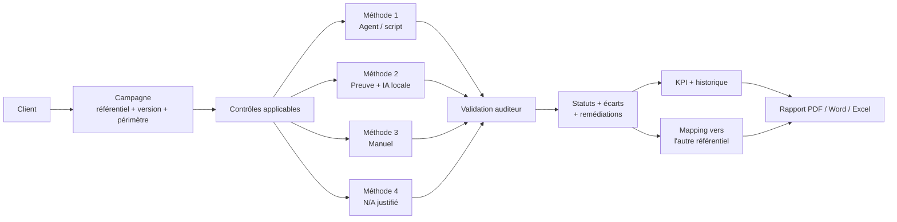
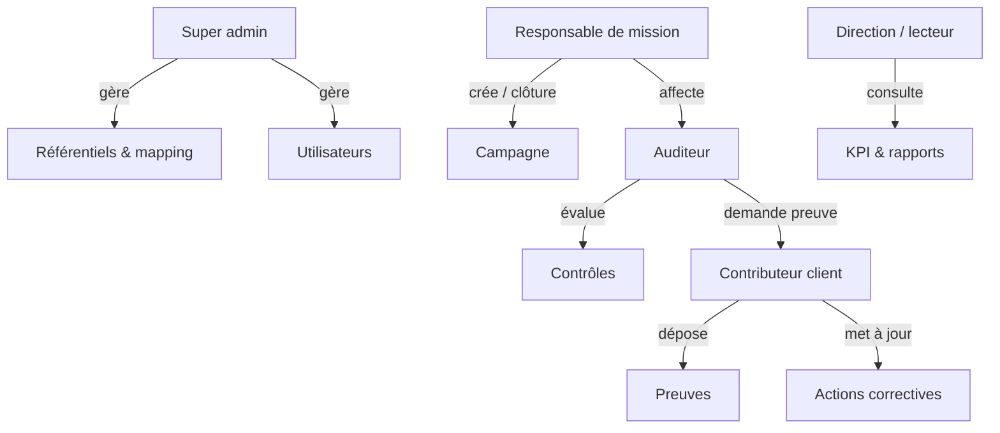
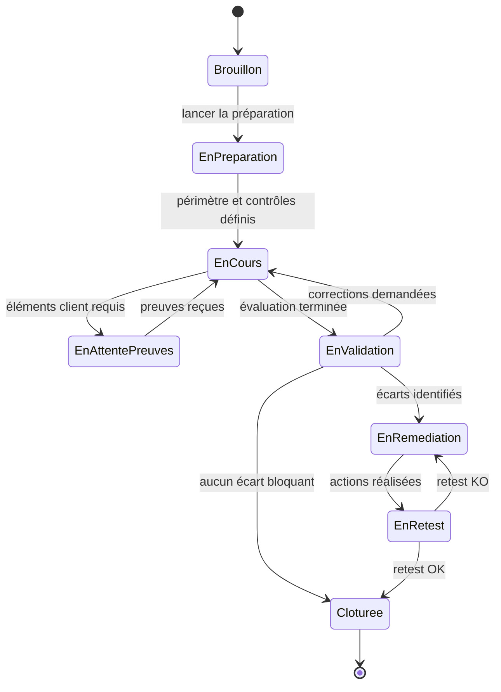

# 01 — Sujet détaillé du PFE

> **Titre :** Conception et implémentation d'une plateforme d'automatisation des contrôles de conformité : application aux référentiels PCI DSS et GIE Monétique
> **Entreprise :** Mare Nostrum Advising Group — MNA Algérie (cabinet de conseil, pôle cybersécurité & SI)
> **Source :** cahier des charges `PCI_DSS_PFE_CDC_V12102026.docx` (rédigé le 12/10/2026, révisé le 14/10/2026)

Ce document reprend **chaque section du cahier des charges (CDC)**, explique ce qu'elle veut dire concrètement, et ajoute ce qu'il faut savoir pour la réaliser. Les blocs « 💡 Interprétation » sont mon analyse ; tout le reste est fidèle au CDC.

---

## Table des matières

0. [Résumé en une page](#0-résumé-en-une-page)
1. [Définitions et contexte](#1-définitions-et-contexte)
2. [Enjeux et besoins d'automatisation](#2-enjeux-et-besoins-dautomatisation)
3. [Objectifs du projet](#3-objectifs-du-projet)
4. [Acteurs et rôles](#4-acteurs-et-rôles)
5. [Gestion multi-clients et campagnes](#5-gestion-multi-clients-et-campagnes)
6. [Gestion des référentiels et des versions](#6-gestion-des-référentiels-et-des-versions)
7. [Modes d'évaluation](#7-modes-dévaluation-pci-dss--gie-monétique)
8. [Mapping croisé PCI DSS ↔ GIE](#8-mapping-croisé-pci-dss--gie-monétique)
9. [Démarche d'une campagne](#9-démarche-dune-campagne-dévaluation)
10. [Les 4 méthodes d'évaluation](#10-méthodes-dévaluation-des-contrôles)
11. [Preuves et IA locale](#11-gestion-des-preuves-et-ia-locale)
12. [Résultats, scoring, KPI, historique](#12-résultats-scoring-kpi-et-historique)
13. [Reporting](#13-reporting)
14. [Exigences de sécurité](#14-exigences-de-sécurité)
15. [Exigences non fonctionnelles](#15-exigences-non-fonctionnelles)
16. [Phasage et livrables](#16-phasage-et-livrables)
17. [Analyse critique : difficultés, risques et ambiguïtés](#17-analyse-critique--difficultés-risques-et-ambiguïtés)
18. [Ce que le jury attendra](#18-ce-que-le-jury-attendra)

---

## 0. Résumé en une page

**Le problème.** Un cabinet comme MNA réalise des audits de conformité pour des banques, des établissements de paiement ou des prestataires monétiques. Ces audits suivent deux référentiels :
- **PCI DSS** (international, imposé par les marques de cartes Visa/Mastercard… à quiconque stocke, traite ou transmet des données de carte) ;
- **le référentiel du GIE Monétique** (algérien, imposé aux membres du réseau interbancaire CIB).

Aujourd'hui, tout est manuel : listes Excel de centaines d'exigences, preuves envoyées par mail, rapport rédigé à la main. Les deux référentiels se recoupent fortement (le référentiel GIE est **inspiré de PCI DSS et d'ISO 27000**), donc on vérifie souvent **deux fois la même chose**.

**La solution demandée.** Une **plateforme web sécurisée, multi-clients**, qui :

**Les 3 « points durs » qui font la valeur du PFE :**
1. **Le modèle générique et versionné des référentiels** (rien de figé dans le code).
2. **Le moteur de mapping** avec des règles de calcul rigoureuses (complet / partiel / multiple / aucun).
3. **L'automatisation** : scripts de collecte (Active Directory, Windows, Linux…) + **IA locale** (LLM hébergé en interne, sans envoi à un service cloud) qui propose un résultat **explicable** que l'auditeur valide.

**Principe fondamental qui traverse tout le CDC :** *l'automatisation assiste, l'humain décide.* Tout résultat automatique ou IA est une **proposition** traçable, validée par un auditeur.

---

## 1. Définitions et contexte

### 1.1 PCI DSS
**Ce que dit le CDC :** référentiel de sécurité visant à protéger les données de cartes de paiement et les environnements qui les stockent, traitent ou transmettent. Couvre réseau, systèmes, protection des données, vulnérabilités, contrôle d'accès, journalisation, tests de sécurité, gouvernance.

**Ce qu'il faut savoir en plus :**
- Publié par le **PCI Security Standards Council (PCI SSC)**, fondé par American Express, Discover, JCB, Mastercard et Visa.
- **Version en vigueur : PCI DSS v4.0.1** (publiée en juin 2024, seule version valide depuis le 31/12/2024). Les exigences « future-dated » de la v4.0 sont obligatoires depuis le **31 mars 2025**. Une consultation publique pour la prochaine version a eu lieu de juin à juillet 2026 : **une nouvelle version peut sortir pendant votre PFE** → c'est exactement pourquoi le CDC exige le versioning des référentiels.
- Structure : **12 exigences principales** regroupées en **6 objectifs**, déclinées en **plusieurs centaines de sous-exigences**, chacune avec des **procédures de test** (examiner, interroger, observer, tester).
- Détails complets → [connaissances/PCI_DSS_Guide.md](connaissances/PCI_DSS_Guide.md).

### 1.2 Référentiel GIE Monétique
**Ce que dit le CDC :** le GIE Monétique intervient dans l'écosystème monétique interbancaire algérien. Le référentiel GIE désigne l'ensemble des exigences de sécurité à évaluer pour les acteurs concernés. **La version officielle mise à disposition du projet devra être importée et administrée dans la plateforme.**

**Ce qu'il faut savoir en plus :**
- **GIE = Groupement d'Intérêt Économique** créé par les banques algériennes, Algérie Poste et la Banque d'Algérie pour gérer le système de paiement par carte interbancaire **CIB** (et l'interopérabilité avec la carte EDAHABIA d'Algérie Poste).
- Selon des responsables du GIE (interview 2022), le référentiel compte **plus de 350 exigences de sécurité**, **inspiré de PCI DSS et ISO 27000**, couvrant carte, ATM (GAB), TPE, interfaces, routage et processing. Des **audits externes** des banques étaient prévus.
- ⚠️ **Le texte du référentiel n'est pas public.** Vous **devez** l'obtenir via MNA. C'est le **premier blocage à lever**.
- Détails → [connaissances/GIE_Monetique_et_Contexte_Algerien.md](connaissances/GIE_Monetique_et_Contexte_Algerien.md).

### 1.3 Contexte du projet
Les évaluations reposent sur des opérations manuelles : analyse de nombreuses exigences, collecte/examen de preuves techniques et documentaires, vérification, consolidation dans un rapport. Conséquences : coût en temps, différences d'appréciation entre intervenants, preuves mal structurées.

**Objectif :** centraliser, standardiser et automatiser **une partie** du processus, **en conservant la validation de l'auditeur** pour les contrôles nécessitant une appréciation humaine.

> 💡 **Interprétation :** le mot clé est « une partie ». Le jury ne vous demandera pas d'automatiser 100 % de PCI DSS (impossible : sécurité physique, entretiens, politiques…). Il faudra **mesurer** et **montrer** quelle proportion vous automatisez (ex. « 18 % des exigences PCI DSS sont vérifiables par script, 45 % assistées par IA, le reste manuel ») — c'est un excellent résultat chiffré pour le mémoire.

---

## 2. Enjeux et besoins d'automatisation

**Problématique centrale :** *réduire la dépendance aux traitements manuels tout en conservant une validation humaine quand elle est nécessaire.* La plateforme doit **automatiser ce qui peut l'être, structurer le reste, et fournir une traçabilité complète.**

> 💡 Cette phrase est presque mot pour mot la **problématique** de votre mémoire. Gardez-la.

### 2.1 Limites du fonctionnement manuel (le « pourquoi »)
| Limite | Ce que la plateforme y répond |
|---|---|
| Preuves dispersées (mails, dossiers, Excel) | Dépôt centralisé, métadonnées, hash, rattachement aux contrôles |
| Répétition des mêmes contrôles (campagnes, référentiels) | Réutilisation des preuves + mapping croisé |
| Difficile de comparer deux évaluations | Historique des campagnes + KPI d'évolution |
| Pas de vision consolidée des écarts/actions | Module non-conformités / plan d'action / échéances |
| KPI et rapport produits à la main | Calcul automatique + génération de rapport |
| Incohérence entre évaluateurs, perte de traçabilité | Statuts normalisés, commentaires obligatoires, journal d'audit |

### 2.2 Apports attendus
Centraliser · automatiser les collectes techniques · analyser localement les preuves · uniformiser méthode et statuts · conserver l'historique · calculer KPI/tendances · générer rapport + plan d'amélioration · exploiter le mapping pour éviter les vérifications redondantes.

---

## 3. Objectifs du projet

### 3.1 Objectif principal
> Développer une **plateforme web sécurisée** permettant de **réaliser, automatiser et piloter** des évaluations de conformité PCI DSS et GIE Monétique pour **plusieurs clients**, tout en assurant le **mapping croisé** entre les deux référentiels et la **conservation de l'historique** de chaque campagne.

### 3.2 Objectifs fonctionnels (à transformer en exigences numérotées)
| ID | Objectif | Module correspondant |
|---|---|---|
| OF-1 | Gérer plusieurs clients dans une même plateforme | Clients / multi-tenant |
| OF-2 | Plusieurs campagnes par client | Campagnes |
| OF-3 | Choisir PCI DSS **ou** GIE comme référentiel principal | Campagnes + Référentiels |
| OF-4 | Appliquer un mapping croisé vers l'autre référentiel | Moteur de mapping |
| OF-5 | Gérer 4 méthodes d'évaluation par contrôle | Évaluation |
| OF-6 | Centraliser preuves et analyses | Preuves + IA |
| OF-7 | Identifier non-conformités et pistes d'amélioration | Constats / recommandations |
| OF-8 | Suivre actions correctives et retests | Remédiation |
| OF-9 | Produire KPI, comparaisons historiques, rapports | Dashboard + Reporting |

---

## 4. Acteurs et rôles

| Rôle | Responsabilités (CDC) | Côté | Exemples d'actions |
|---|---|---|---|
| **Super administrateur** | Administration globale, référentiels, mapping, sécurité, paramétrage | MNA | Importer PCI DSS v4.0.1, publier une version, éditer le mapping, gérer les comptes |
| **Responsable de mission** | Création des campagnes, périmètre, équipe, supervision, clôture | MNA | Créer la campagne « Banque X – 2027 », affecter auditeurs, valider les N/A, clôturer |
| **Auditeur / évaluateur** | Réalisation des contrôles, validation des analyses, constats, recommandations | MNA | Lancer un script AD, valider la proposition IA, saisir un constat |
| **Contributeur client** | Dépôt de preuves, réponses aux demandes, suivi des actions affectées | Client | Uploader la politique de mots de passe, répondre à une demande, mettre à jour une action |
| **Direction / lecteur** | Consultation KPI, synthèses, historique, rapports | MNA ou client | Voir le dashboard, télécharger le rapport |

> 💡 **Interprétation :** les rôles se combinent avec le **périmètre** : un auditeur n'a accès qu'aux campagnes où il est affecté ; un contributeur client ne voit **que son client** et seulement les demandes qui le concernent. C'est un **RBAC contextuel** (rôle × client × campagne × action) → voir [conception/Securite_Plateforme.md](conception/Securite_Plateforme.md).

---

## 5. Gestion multi-clients et campagnes

La plateforme fonctionne en **multi-clients avec cloisonnement strict**. Chaque client a son espace logique et un **nombre illimité d'évaluations** (Figure 2 du CDC : *PCI Conformity Manager* → Client A/B/C → Éval. N, Éval. N+1 → Historique • KPI • Rapports • Actions).

### 5.1 Fiche client
- Raison sociale et informations générales
- Contacts principaux, responsables sécurité / conformité (RSSI, DPO…)
- Périmètres habituels et actifs principaux (serveurs, applications, réseaux, sites)
- Liste des campagnes passées et en cours
- Documents généraux **réutilisables après validation** (ex. PSSI, organigramme)

### 5.2 Campagne d'évaluation
À la création : **client, nom, référentiel principal, version, dates, équipe, périmètre, actifs**.

**Cycle de vie (8 statuts) :**

| Statut | Description |
|---|---|
| Brouillon | Créée mais non lancée |
| En préparation | Périmètre et contrôles en cours de définition |
| En cours | Évaluation active |
| En attente de preuves | Éléments client requis |
| En validation | Résultats en revue par l'auditeur |
| En remédiation | Actions correctives en cours |
| En retest | Vérification après correction |
| Clôturée | **Résultats figés** et rapport final produit |

> 💡 Les transitions ne sont pas listées dans le CDC : le diagramme ci-dessus est une **proposition** à valider avec MNA. « Clôturée » = **immuable** (lecture seule), indispensable pour l'historique.

---

## 6. Gestion des référentiels et des versions

**Exigence clé :** la plateforme doit être **agnostique du référentiel**. Chaque référentiel est **structuré, configurable et versionné**. Les **règles d'évaluation, contrôles, critères d'applicabilité et méthodes de vérification ne doivent pas être figés dans le code** → ils sont **des données** administrables. PCI DSS et GIE ne sont que **deux cas d'application** de ce moteur générique.

> 💡 Conséquence technique : il faut un **format d'import** (JSON/YAML/Excel) décrivant un référentiel. Demain, MNA doit pouvoir importer ISO 27001 ou SWIFT CSCF **sans toucher au code**. C'est un argument fort pour le jury (« architecture extensible »). Inspiration : le format **OSCAL** du NIST et la bibliothèque de référentiels de **CISO Assistant** (voir [Etat_de_l_Art.md](connaissances/Etat_de_l_Art.md)).

### 6.1 Modèle générique d'un contrôle
| Champ | Description | Exemple PCI DSS |
|---|---|---|
| Identifiant | Référence unique dans le référentiel | `8.3.6` |
| Domaine | Famille / chapitre | Exigence 8 — Identifier les utilisateurs et authentifier l'accès |
| Titre / description | Texte synthétique | Longueur et complexité des mots de passe |
| Critères d'évaluation | Conditions pour conclure | Longueur ≥ 12 caractères, chiffres + lettres |
| Applicabilité | Règles déterminant si le contrôle concerne le périmètre | Applicable si authentification par mot de passe |
| Méthode(s) autorisée(s) | Agent/script, preuve + IA, manuel, N/A | Script AD, preuve + IA (politique), manuel |
| Preuves attendues | Documents, configs, exports, logs, captures | Export GPO, politique de mots de passe |
| Recommandation type | Piste d'amélioration générique | Configurer une politique ≥ 12 caractères via GPO/FGPP |
| Mappings | Relations vers les contrôles de l'autre référentiel | → GIE `x.y.z` (complet) |

> 💡 Ajouter aussi (utile en pratique) : **criticité** par défaut, **procédures de test**, **règles d'automatisation** (ex. `min_password_length >= 12`), **parent** (hiérarchie exigence → sous-exigence), **ordre d'affichage**.

### 6.2 Gestion des versions
- Plusieurs versions par référentiel.
- La version est **sélectionnée à la création de la campagne** et **conservée** jusqu'à la fin.
- Une nouvelle version **ne modifie jamais rétroactivement** les campagnes lancées ou clôturées.
- Objectif : traçabilité, **reproductibilité**, historique.

> 💡 Technique : une version publiée est **immuable** (statut `brouillon → publiée → dépréciée`). Les campagnes pointent vers `ReferentialVersion` et ses `Control` ; pour comparer deux campagnes sur deux versions différentes, il faudra une **table de correspondance inter-versions** (ex. PCI v4.0.1 → v5). Détails → [conception/Modele_de_Donnees.md](conception/Modele_de_Donnees.md).

---

## 7. Modes d'évaluation PCI DSS / GIE Monétique

*(Figure 1 du CDC : Mode 1 Évaluation PCI DSS → Résultats PCI DSS → Moteur de mapping ← Résultats GIE ← Mode 2 Évaluation GIE ; le moteur produit la « Couverture croisée estimée (complet / partiel / non couvert) ».)*

- **Mode PCI DSS** : PCI DSS = référentiel principal → on évalue les contrôles applicables → le moteur calcule la **couverture estimée du GIE**.
- **Mode GIE Monétique** : GIE = principal → on évalue → projection vers PCI DSS pour identifier les exigences **entièrement / partiellement / non couvertes**.

> 💡 Les deux modes sont **symétriques** : un seul moteur de mapping bidirectionnel, pas deux implémentations.

---

## 8. Mapping croisé PCI DSS ↔ GIE Monétique

**Fonction centrale.** Associer **un ou plusieurs** contrôles PCI DSS à **un ou plusieurs** contrôles GIE, et inversement (relations **N–N**).

| Type de mapping | Interprétation |
|---|---|
| **Complet** | Le contrôle évalué couvre **toutes** les attentes du contrôle cible |
| **Partiel** | Couvre **une partie** seulement |
| **Multiple** | **Plusieurs** contrôles doivent être réunis pour couvrir la cible |
| **Aucun** | Aucune correspondance ; la cible reste à évaluer séparément |

### 8.1 Règles de calcul (à implémenter exactement)
1. Un mapping **complet** peut transmettre un résultat de couverture, **sous réserve de cohérence des périmètres et des preuves**.
2. Un mapping **partiel ne peut jamais** produire automatiquement « Conforme » sur la cible.
3. Un mapping **multiple** exige que **tous** les contrôles nécessaires soient pris en compte.
4. Un contrôle **non mappé reste non couvert** jusqu'à évaluation directe.
5. Toute règle de mapping est **versionnée, documentée et administrable**.

### 8.2 Restitution de la couverture croisée
| Indicateur | Signification |
|---|---|
| Couvert | Exigence cible suffisamment couverte par le mapping |
| Partiellement couvert | Une partie des attentes est couverte |
| Non couvert | Aucun résultat suffisant disponible |
| Non mappé | Aucune correspondance définie |
| À vérifier | Correspondance ou périmètre nécessitant une validation humaine |

> ⚠️ **Important (CDC) :** le niveau obtenu par mapping est une **couverture estimée**, **jamais** une évaluation directe.

> 💡 L'algorithme complet (table de décision, pseudo-code, cas limites) est dans [connaissances/Mapping_Croise.md](connaissances/Mapping_Croise.md). **La construction du mapping lui-même (des centaines de correspondances) est un travail d'expert** : à faire avec MNA, à commencer très tôt.

---

## 9. Démarche d'une campagne d'évaluation

*(Figure 3 du CDC)*

> 💡 C'est le **scénario de démonstration** de votre soutenance : faites-le dérouler de bout en bout sur un client fictif (« Banque Démo ») en 10 minutes.

---

## 10. Méthodes d'évaluation des contrôles

*(Diagramme SmartArt du CDC : Agent/Script — collecte automatique AD, OS, firewall, SIEM… ; Preuve + IA locale — analyse d'un document, export ou configuration ; Manuel — entretien, observation, saisie ; N/A — non applicable avec justification obligatoire.)*

### 10.1 Méthode 1 — Agent, script ou connecteur
Vérification à partir d'infos collectées **directement** sur le système cible : Active Directory, Windows, Linux, firewall, SIEM, base de données…
- Lecture seule autant que possible
- Compte technique dédié, **moindre privilège**
- Transmission **chiffrée**
- **Normalisation** des valeurs collectées
- Comparaison avec les critères du contrôle
- Résultat automatique conservant **valeur observée** et **valeur attendue**

> 💡 Exemple : script PowerShell qui lit la *Default Domain Password Policy* → `MinPasswordLength = 8` ; critère PCI 8.3.6 = 12 → résultat proposé **Non conforme**, observé `8`, attendu `≥ 12`, horodatage, hash du résultat brut.

### 10.2 Méthode 2 — Preuve déposée + analyse par IA locale
L'utilisateur dépose une preuve ; l'**IA locale** analyse, identifie les éléments pertinents, propose un résultat **avec justification**.
- **Aucune transmission vers un service d'IA public** par défaut
- Indication des **passages utilisés** (citations)
- **Score de confiance distinct** du statut de conformité
- L'auditeur peut **accepter, modifier, rejeter, demander une preuve complémentaire**

### 10.3 Méthode 3 — Évaluation manuelle
Formulaire structuré : entretiens, observations, contrôles physiques, organisationnels, non automatisables.
- Réponse structurée · **commentaire obligatoire si négatif/partiel** · preuve jointe possible · constat + recommandation.

### 10.4 Méthode 4 — N/A
Réservé aux contrôles **réellement** non applicables. **Justification obligatoire** conservée dans l'historique : motif, commentaire, preuve éventuelle, **nom de l'évaluateur et date**, revue possible par le responsable de mission.

> 💡 En PCI DSS, un N/A abusif est un piège classique d'audit (un QSA doit documenter chaque N/A). La validation par le responsable de mission est donc une vraie bonne pratique à implémenter (workflow « N/A proposé → N/A validé »).

Détails techniques → [connaissances/Methodes_Evaluation_et_IA_Locale.md](connaissances/Methodes_Evaluation_et_IA_Locale.md).

---

## 11. Gestion des preuves et IA locale

### 11.1 Types de preuves
PDF, DOCX, XLSX, CSV · images/captures · fichiers de configuration · exports système et logs · rapports de scan/vulnérabilités · résultats des agents/scripts.

### 11.2 Métadonnées de preuve
| Métadonnée | Objectif |
|---|---|
| Identifiant | Référence unique |
| Client / campagne | Rattachement et **cloisonnement** |
| Contrôle(s) | Association à une ou plusieurs exigences |
| Source | Origine (dépôt manuel, script X, connecteur Y) |
| Date | Date de collecte / du document |
| Auteur / déposant | Traçabilité |
| **Hash** | Contrôle d'intégrité (SHA-256) |
| Statut | À analyser, validée, rejetée, obsolète |

### 11.3 Analyse locale par IA
L'IA est un **mécanisme d'assistance** : extraire les infos d'une politique, analyser une config, rechercher les éléments attendus. **Toute conclusion explicable et validable.**

### 11.4 Réutilisation et obsolescence
- Une preuve peut servir **plusieurs contrôles**.
- Une preuve d'une campagne précédente peut être **proposée** à la réutilisation mais **doit être revalidée**.
- Signalement des preuves **anciennes / potentiellement obsolètes** (ex. scan > 3 mois, alors que PCI exige des scans trimestriels).

---

## 12. Résultats, scoring, KPI et historique

### 12.1 Statuts d'un contrôle (7)
| Statut | Signification |
|---|---|
| Conforme | Critère satisfait |
| Partiellement conforme | Critère partiellement satisfait |
| Non conforme | Critère non satisfait |
| À vérifier | Résultat automatique ou IA en attente de validation |
| En attente de preuve | Bloqué par l'absence d'élément |
| Non évalué | Aucune évaluation |
| N/A | Non applicable avec justification |

> 💡 Distinguer **statut proposé** (par le script/IA) et **statut validé** (par l'auditeur). « À vérifier » = proposé non encore validé.

### 12.2 KPI principaux
Total contrôles · applicables · évalués · conformes / partiels / non conformes · **taux d'avancement** · **taux de satisfaction interne** · écarts par criticité · actions ouvertes / clôturées / en retard · **couverture estimée de l'autre référentiel** · **évolution vs campagne précédente**.

> 💡 Formules proposées (à valider avec MNA, car « taux de satisfaction interne » n'est pas défini dans le CDC) :
> - Taux d'avancement = évalués (hors « Non évalué », « En attente », « À vérifier ») / applicables
> - Taux de conformité = (Conformes + 0,5 × Partiels) / (applicables évalués) — pondération à paramétrer
> - Couverture croisée = contrôles cibles « Couverts » / contrôles cibles applicables

---

## 13. Reporting

Génération **automatique** d'un rapport détaillé + exports synthétiques.

### 13.1 Structure du rapport détaillé
1. Page de garde et identification de la campagne
2. Contexte, objectifs, référentiel utilisé
3. Périmètre et exclusions
4. Méthodologie et 4 méthodes d'évaluation
5. Synthèse exécutive
6. KPI et état global
7. Résultats par domaine
8. Résultats détaillés contrôle par contrôle
9. Liste des non-conformités
10. Pistes d'amélioration et plan d'action
11. Résultat du mapping vers l'autre référentiel
12. Conclusion et réserves éventuelles

### 13.2 Formats
PDF (diffusible) · Excel (résultats + plan d'action) · **Word (recommandé, personnalisable)** · CSV / JSON (intégrations).

> 💡 Bibliothèques : WeasyPrint (PDF depuis HTML), docxtpl / python-docx (Word à partir d'un modèle MNA), openpyxl (Excel). La « synthèse exécutive » peut être **pré-rédigée par l'IA locale** puis éditée par l'auditeur.

---

## 14. Exigences de sécurité

La plateforme contient des **informations extrêmement sensibles** : architectures, configurations et **faiblesses** des clients (une cible de rêve pour un attaquant). Sécurité **by design**.

| Exigence | Attente minimale |
|---|---|
| Authentification | Comptes nominatifs, politique forte, **MFA** pour les rôles sensibles |
| RBAC | Droits selon **rôle, client, campagne et action** |
| Isolation | Aucune donnée d'un client accessible à un autre |
| Chiffrement | **TLS** en transit, chiffrement des données sensibles **au repos** |
| Secrets | **Coffre de secrets** pour identifiants de connecteurs et clés |
| Journalisation | Connexions, modifications, validations, exports, admin |
| Clean code | Code clair, lisible, structuré, maintenable, revues facilitées |
| Fichiers | Contrôle du type, taille, **antivirus**, stockage sécurisé |
| Sauvegardes | Base, preuves, référentiels, rapports |
| IA locale | **Pas d'envoi externe** des preuves sans mécanisme explicitement autorisé |

### 14.1 Journal d'audit — événements obligatoires
Création/modification/clôture de campagne · ajout/suppression/remplacement de preuve · changement de statut d'un contrôle · validation d'un résultat IA/automatique · attribution d'un N/A · création/clôture d'une non-conformité · export/génération de rapport · changements d'administration et de mapping.

> 💡 Ironie à exploiter dans le mémoire : la plateforme doit elle-même respecter les principes PCI DSS (exigences 7, 8, 10…). Vous pouvez faire une **auto-évaluation** de votre plateforme avec votre plateforme ! Voir [conception/Securite_Plateforme.md](conception/Securite_Plateforme.md).

---

## 15. Exigences non fonctionnelles

| Domaine | Exigence |
|---|---|
| Ergonomie | Navigation : **Client → Campagne → Domaine → Contrôle → Preuve → Résultat** |
| Performance | Temps de réponse adapté + **traitement asynchrone** des analyses lourdes (IA, scripts) |
| Scalabilité | Plusieurs clients et campagnes simultanés |
| Disponibilité | À définir selon hébergement |
| Maintenabilité | Référentiels, mappings, règles **modifiables sans recompilation** |
| Traçabilité | Historique complet des décisions et modifications |
| Interopérabilité | Connecteurs et **API** |
| Déploiement | **On-premise** ou environnement privé |

> 💡 « On-premise » + « IA locale » ⇒ tout doit tourner **sans Internet** chez MNA ou chez le client : conteneurs Docker, modèle LLM téléchargé à l'avance, pas de CDN externe.

---

## 16. Phasage et livrables

### 16.1 Phasage recommandé par MNA
| Lot | Contenu |
|---|---|
| **Lot 1 — Socle** | Multi-clients, campagnes, référentiels, saisie manuelle, N/A, preuves, statuts, KPI, historique, rapports |
| **Lot 2 — Automatisation** | Agents/scripts, Active Directory et premiers connecteurs, moteur de règles |
| **Lot 3 — IA locale** | Analyse de preuves, extraction, justification, validation auditeur |
| **Lot 4 — Mapping avancé** | Administration des correspondances, calcul de couverture croisée, corrélation des preuves |

### 16.2 Livrables attendus (10)
1. Spécifications fonctionnelles détaillées
2. Architecture technique et modèle de données
3. Maquettes UX/UI
4. Code source et scripts de déploiement
5. Référentiels et mappings importables
6. Agents / scripts dans le périmètre retenu
7. Documentation administrateur et utilisateur
8. Documentation API
9. Jeux de tests et rapport de recette
10. **Rapport de sécurité avant mise en production**

---

## 17. Analyse critique : difficultés, risques et ambiguïtés

| # | Point | Pourquoi c'est un risque | Que faire |
|---|---|---|---|
| R1 | **Référentiel GIE non public** | Sans lui : pas de Mode 2, pas de mapping réel | Le demander **semaine 1** ; en attendant, travailler avec un **référentiel GIE fictif** (structure plausible) pour ne pas bloquer le dev |
| R2 | **Périmètre énorme** (4 lots = travail d'une équipe produit sur 1 an) | Risque de tout faire à moitié | Négocier un **MVP** : Lot 1 complet + Lot 2 (AD + Linux/Windows) + Lot 3 (PoC solide sur 2–3 types de preuves) + Lot 4 (moteur + mapping sur 1–2 domaines). Voir [02_Plan_Roadmap.md](02_Plan_Roadmap.md) |
| R3 | **Construction du mapping = expertise** | Des centaines de paires à qualifier (complet/partiel…) | Brouillon assisté (IA/Claude) **+ validation par un consultant MNA**. Commencer tôt, en parallèle du dev |
| R4 | **Matériel pour l'IA locale** | Un LLM utile demande un GPU (≥ 12–24 Go VRAM) ou sera lent sur CPU | Demander le matériel ; prévoir des modèles de tailles différentes ; traitement asynchrone |
| R5 | **Fiabilité de l'IA** (hallucinations) | Un faux « Conforme » est grave en audit | Citations obligatoires, score de confiance, jamais de validation automatique, jeu de test d'évaluation |
| R6 | **Accès à des systèmes réels** pour les scripts | Pas d'accès aux SI des clients pendant un PFE | **Laboratoire virtuel** (VMware : Windows Server AD, Linux, pfSense, Wazuh) |
| R7 | **Droits sur le texte PCI DSS** | Le document PCI SSC est sous licence (téléchargement gratuit avec acceptation) | Importer les identifiants + résumés ; vérifier avec MNA l'usage interne du texte intégral |
| R8 | **Ambiguïtés du CDC** | « Taux de satisfaction interne », transitions de statuts, criticité, disponibilité, stack imposée ? | Liste dans [Questions_Encadrant.md](organisation/Questions_Encadrant.md) |
| R9 | **Sécurité de la plateforme** | Elle concentre les failles des clients | Threat model + pentest interne + rapport de sécurité (livrable 10) |

---

## 18. Ce que le jury attendra

1. **Une problématique claire** (section 2) et un **état de l'art** (outils GRC existants, pourquoi ils ne suffisent pas : pas de GIE, pas d'IA locale, pas de mapping avec règles de couverture strictes, contexte on-premise algérien).
2. **Une démarche d'ingénierie** : analyse des besoins → conception (UML, architecture, modèle de données) → réalisation → tests → sécurité.
3. **Une démonstration fonctionnelle** du scénario de la Figure 3.
4. **Des résultats mesurés** : % de contrôles automatisables, précision de l'IA sur un jeu de test, gain de temps estimé vs manuel, taux de couverture croisée obtenu.
5. **La dimension cybersécurité** (vous êtes en ingéniorat cyber !) : sécurité de la plateforme, threat model, pentest, conformité de la plateforme elle-même, sécurité des agents de collecte, souveraineté des données (IA locale).
6. **Les limites et perspectives** honnêtes (autres référentiels, plus de connecteurs, fine-tuning du modèle…).
