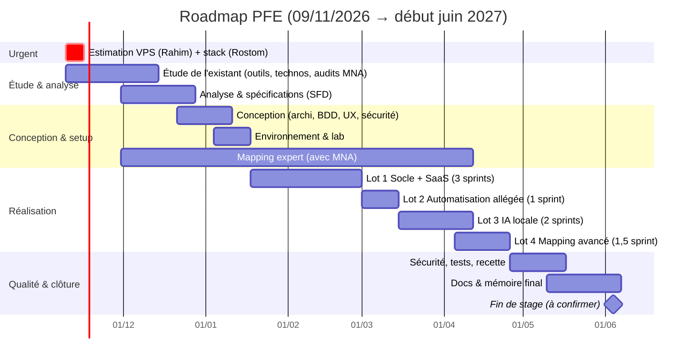

# 02 — Plan complet & Roadmap du PFE

> Plan étape par étape, avec **objectif, tâches, méthode, livrables, durée, répartition binôme**, et pour chaque tâche **ce que Claude peut faire (🤖), aider à faire (🤝) ou ne peut pas faire (🙋)**.
> **Mis à jour le 09/11/2026** après la réunion de lancement du 05/11/2026 → voir [CR_2026-11-05_Reunion_lancement.md](organisation/Comptes_Rendus/CR_2026-11-05_Reunion_lancement.md).

---

## 0. Hypothèses de planification

| Hypothèse | Valeur retenue | Statut |
|---|---|---|
| Durée du stage | **Du lundi 09/11/2026 à début juin 2027** (~30 semaines). Date de fin exacte et date de soutenance **à confirmer** | 🟡 Fin à confirmer |
| Binôme | **Rostom** et **Rahim** — rôles A/B à attribuer (voir [Organisation_Binome.md](organisation/Organisation_Binome.md)) | ✅ |
| Encadrants MNA | **Noor** et **Rabah** — contact par **e-mail ou téléphone** | ✅ |
| Présence chez MNA | **Chaque lundi** | ✅ |
| Réunions d'avancement | **Toutes les 2 semaines**, avec **compte rendu** à chaque réunion | ✅ |
| Méthode | **Scrum léger** : sprints de 2 semaines alignés sur les réunions d'avancement (démo à chaque réunion) | ✅ |
| CDC | **Brouillon flexible**, adaptable aux besoins métier | ✅ (réunion 05/11) |
| Référentiels | **PCI DSS v4.0.1** + **GIE Monétique** (basé sur PCI DSS **3.2**). **Pas** d'anciennes versions PCI à importer | ✅ (D8) |
| Déploiement | **Deux modes** : A. service (MNA audite ses clients) · B. **SaaS sous licence** (audits internes d'entreprises) | ✅ (D11) |
| Méthode Agent/Script | **Commandes bien définies**, incluse mais **pas prioritaire** | ✅ (D9) |
| Sortie IA | **Statut + explication + justification**, **pas de chatbot** | ✅ (D10) |
| Matériel | VPS à demander : estimation **avant le 16/11** (Rahim) — voir [Estimation_Ressources_VPS.md](conception/Estimation_Ressources_VPS.md) | 🟡 En cours |
| Stack | Libre, choix par **Rostom avant le 16/11** — voir [Choix_Technologiques.md](conception/Choix_Technologiques.md) | 🟡 En cours |
| Rythme | ~35 h chacun/semaine → ~70 h binôme/semaine | — |

> **Volume :** ~30 semaines × 70 h ≈ **2 100 h binôme**, dont ~4 semaines de finalisation du mémoire. Plus confortable que la version précédente (24 semaines), mais l'étude de l'existant est plus longue et le mode SaaS ajoute du travail → la stratégie MVP reste nécessaire.

---

## 1. Stratégie : un MVP solide plutôt que 4 lots à moitié

| Lot | Niveau visé pour le PFE (MVP) | « Bonus » si le temps le permet |
|---|---|---|
| Lot 1 — Socle | **100 %** des fonctions du CDC + **socle d'audit générique** (périmètre, contrôles, applicabilité — D6) + **multi-organisation / licences** (mode SaaS — D11) | Notifications e-mail, SSO par organisation (Keycloak), comparaison fine N vs N+1 |
| Lot 2 — Automatisation (**allégé**, D9) | Moteur de règles générique + **bibliothèque de commandes fixes en lecture seule** : Active Directory + Linux (Windows si temps) | Firewall, SIEM, base de données, connecteur distant |
| Lot 3 — IA locale | Analyse de **3 types de preuves** (politique PDF/DOCX, config, export CSV) → **statut + justification + citations + confiance** (pas de chatbot) | OCR, RAG multi-documents, synthèse exécutive |
| Lot 4 — Mapping | Moteur complet (4 types, 5 indicateurs, versionné) + **mapping GIE ↔ PCI DSS v4.0.1 validé sur 2–3 domaines**, en s'appuyant sur la correspondance PCI 3.2.1 → 4.0 [S2] | Mapping complet, suggestions par embeddings |

**Principes conservés :** modèle de données du mapping conçu dès la conception ; travail d'expert du mapping lancé tôt, en parallèle.

**Nouveau principe (D6 + D11) :** la plateforme = **socle d'audit générique multi-organisation** + **modules référentiels** (PCI DSS, GIE…). Le module PCI DSS ne contient pas de logique codée en dur : ce sont des données (CDC § 6).

---

## 2. Vue d'ensemble (Gantt)

| Phase | Semaines (S1 = 09/11/2026) | Jalons (présentés en réunion d'avancement) |
|---|---|---|
| ⚡ Urgent | S1 (09–15/11) | ✅ J0 : estimation VPS + stack envoyées à MNA **avant le 16/11** |
| 1. Étude de l'existant | S1–S5 (09/11–13/12) — peut être plus courte | ✅ J1 : rapport d'étude de l'existant (outils, technologies, processus d'audit MNA) + chapitre 1 du mémoire en brouillon |
| 2. Analyse & spécifications | S4–S7 (30/11–27/12) | ✅ J2 : SFD validée |
| 3. Conception | S7–S9 (21/12–10/01) | ✅ J3 : architecture + modèle de données + maquettes + threat model validés |
| 4. Environnement & lab | S9–S10 (04/01–17/01) | ✅ J4 : « Hello world » authentifié déployé sur le VPS + lab AD opérationnel |
| 5. Lot 1 — Socle + SaaS | S11–S16 (18/01–28/02) | ✅ J5 : campagne manuelle complète → rapport, dans 2 organisations isolées |
| 6. Lot 2 — Automatisation allégée | S17–S18 (01/03–14/03) | ✅ J6 : contrôle AD évalué par commande fixe + moteur de règles |
| 7. Lot 3 — IA locale | S19–S22 (15/03–11/04) | ✅ J7 : preuve analysée → statut + justification + citations |
| 8. Lot 4 — Mapping avancé | S22–S24 (05/04–25/04) | ✅ J8 : couverture croisée GIE affichée et dans le rapport |
| 9. Sécurité, tests, recette | S25–S27 (26/04–16/05) | ✅ J9 : rapport de recette + rapport de sécurité |
| 10. Docs & mémoire | S27–S30 (10/05–04/06) | ✅ J10 : mémoire déposé, fin de stage |

**Calendrier des réunions d'avancement (toutes les 2 semaines, à confirmer avec Noor et Rabah) :** R1 05/11 ✅ · R2 ~19/11 · R3 ~03/12 · R4 ~17/12 · R5 ~07/01 · … Un compte rendu par réunion dans [organisation/Comptes_Rendus/](organisation/Comptes_Rendus/).

---

## 3. Le plan détaillé, étape par étape

### ⚡ URGENT — avant le 16/11/2026

| # | Tâche | Qui | Claude |
|---|---|---|---|
| U.1 | **Estimation des ressources du VPS** (CPU/GPU/RAM/stockage/réseau) et envoi à MNA | **Rahim** | 🤖 Brouillon complet fait : [Estimation_Ressources_VPS.md](conception/Estimation_Ressources_VPS.md) ; 🙋 relecture, envoi |
| U.2 | **Choix de la stack** (comparatif pondéré + décision + ADR) | **Rostom** | 🤖 Comparatif fait : [Choix_Technologiques.md](conception/Choix_Technologiques.md) ; 🙋 décision finale selon vos compétences |
| U.3 | Envoyer le CR de la réunion du 05/11 | Rostom | 🤖 Fait : [CR_2026-11-05](organisation/Comptes_Rendus/CR_2026-11-05_Reunion_lancement.md) ; 🙋 envoi |
| U.4 | Lundi 16/11 chez MNA : demander un créneau pour **assister à un audit** côté MNA | Rostom + Rahim | 🙋 |

---

### PHASE 1 — Étude de l'existant (S1–S5, 09/11 → 13/12 au plus tard, ~350 h)

> **Consigne MNA :** c'est une **grande partie** du projet, **y compris sur les technologies**, à terminer **avant janvier**. La durée de 4–5 semaines est indicative : si l'on avance plus vite, on passe à la suite plus tôt. Chaque affirmation doit être **référencée** (articles, normes, docs officielles — pas Wikipédia) → [Bibliographie.md](connaissances/Bibliographie.md).

| # | Tâche | Comment faire | Durée | Qui | Claude |
|---|---|---|---|---|---|
| 1.1 | **Processus d'audit actuel chez MNA** : comment un audit PCI/GIE se déroule, outils (Excel ? Word ?), modèles de rapport, points de douleur | Entretiens avec Noor / Rabah / un auditeur (grille d'entretien) ; récupérer des **modèles anonymisés** | 3 j | A+B | 🤝 Grille d'entretien, synthèse ; 🙋 entretiens |
| 1.2 | **Observer un ou plusieurs audits côté MNA** (autorisé, D1) | Grille d'observation : étapes, preuves demandées, décisions, temps passé, outils → « penser comme un auditeur » ; démarche ISO 19011 [S9] | 2–4 j | A+B | 🤝 Grille d'observation ; 🙋 présence |
| 1.3 | **Étude des référentiels** : PCI DSS v4.0.1 [S1], **changements 3.2.1 → 4.0** [S2] (le GIE est basé sur 3.2), GIE (dès réception) | [PCI_DSS_Guide.md](connaissances/PCI_DSS_Guide.md), [GIE_Monetique_et_Contexte_Algerien.md](connaissances/GIE_Monetique_et_Contexte_Algerien.md) | 4 j | A+B | 🤖 Fiches, quiz, tableau des changements 3.2.1 → 4.0 |
| 1.4 | **Étude des solutions existantes** : CISO Assistant, Eramba, GRC commerciales, Vanta/Drata, scanners (OpenSCAP, Wazuh SCA, PingCastle) | **Installer et tester** CISO Assistant (1–2 j) et un 2e outil ; grille comparative ; positionnement | 5 j | B (+A) | 🤖 Tableau comparatif, procédure d'installation ; 🙋 tests réels |
| 1.5 | **Étude de l'existant technologique** : back-end, front, BDD, multi-tenant SaaS, stockage, IA locale (runtimes, modèles, embeddings), extraction documentaire, rapports | Partir de [Choix_Technologiques.md](conception/Choix_Technologiques.md) et l'approfondir avec références | 4 j | A (+B) | 🤖 Recherche, synthèse, comparatifs |
| 1.6 | **État de l'art scientifique** : LLM/RAG pour la conformité [A1]–[A5], hallucinations et injection de prompt [A6]–[A7], conformité continue [A13], SaaS multi-tenant [A14], mapping (NIST OLIR [S5]) | Lire, résumer chaque article (fiche de lecture ½ page) dans Zotero | 4 j | A+B | 🤖 Recherche d'articles, fiches de lecture ; 🙋 lecture critique |
| 1.7 | **Modèles économiques** des deux modes (service / SaaS sous licence) : comment les éditeurs GRC licencient (par utilisateur, module, organisation) | Comparatif public des offres | 1 j | B | 🤖 |
| 1.8 | **Rédiger le rapport d'étude de l'existant** = chapitre 1 du mémoire (brouillon) | Avec bibliographie | 3 j | A+B | 🤝 Plan, relecture, mise en forme ; 🙋 analyse personnelle |

**Livrables :** rapport d'étude de l'existant (référencé), grilles d'entretien/observation remplies, comparatif des outils testés, chapitre 1 du mémoire en brouillon, bibliographie Zotero.

---

### PHASE 2 — Analyse & spécifications (S4–S7, 30/11 → 27/12, ~250 h)

**Objectif :** livrable 1 — **Spécifications fonctionnelles détaillées (SFD)**.

| # | Tâche | Comment faire | Durée | Qui | Claude |
|---|---|---|---|---|---|
| 2.1 | Acteurs & cas d'utilisation — **dans les deux modes** (A : cabinet ↔ clients ; B : organisation licenciée ↔ ses entités internes) | UML cas d'utilisation global + par module | 2 j | A | 🤖 |
| 2.2 | **Exigences fonctionnelles numérotées** (EF-xx) depuis le CDC + décisions des CR | Une exigence = une phrase testable ; traçabilité CDC/CR → EF | 3 j | A+B | 🤖 Premier jet |
| 2.3 | User stories + critères d'acceptation, MoSCoW | [Backlog_User_Stories.md](conception/Backlog_User_Stories.md) | 2 j | B | 🤖 |
| 2.4 | ENF & exigences de sécurité mesurables (ASVS L2 [S10]) | | 1 j | A | 🤖 |
| 2.5 | Diagrammes de séquence clés | | 2 j | A+B | 🤖 |
| 2.6 | **Matrice exigence PCI → méthode** (commande fixe / IA / manuel / N/A) | Tableur ; valider avec un auditeur MNA (lien avec 1.2) | 3 j | A+B | 🤝 Proposition ; 🙋 validation |
| 2.7 | **Gestion des licences et modules** (mode SaaS) : organisation, licence, modules PCI/GIE activables, quotas | Spécification courte | 1 j | A | 🤖 |
| 2.8 | Faire valider la SFD (réunion d'avancement) | | — | A+B | 🙋 |

---

### PHASE 1bis — Construction du mapping GIE ↔ PCI DSS (S4–S22, ~4 h/semaine)

| # | Tâche | Comment faire | Claude |
|---|---|---|---|
| M.1 | Normaliser les deux référentiels en tableur | Format d'import défini en conception | 🤖 Script Excel → JSON |
| M.2 | **Traduire les références PCI 3.2 du GIE vers PCI DSS v4.0.1** | Le GIE est basé sur PCI DSS 3.2 (D8) : utiliser le *Summary of Changes 3.2.1 → 4.0* [S2] pour retrouver l'exigence 4.0.1 équivalente — accélère énormément le mapping | 🤖 Table de correspondance 3.2.1 → 4.0.1 |
| M.3 | Proposer des correspondances candidates | Par domaine, puis embeddings (bonus Lot 4) | 🤝 Suggestions justifiées |
| M.4 | Qualifier chaque paire (complet / partiel / multiple / aucun) | [Mapping_Croise.md](connaissances/Mapping_Croise.md) | 🤝 Brouillon ; 🙋 décision |
| M.5 | **Validation par Noor / Rabah ou un consultant MNA** | Créneau régulier (ex. le lundi) | 🙋 |
| M.6 | Versionner et importer | JSON dans Git (sans texte confidentiel) | 🤖 |

---

### PHASE 3 — Conception (S7–S9, 21/12 → 10/01, ~200 h)

| # | Tâche | Comment faire | Durée | Qui | Claude |
|---|---|---|---|---|---|
| 3.1 | ADR des choix technologiques (issus de U.2) | 1 page par décision | 1 j | A+B | 🤖 |
| 3.2 | **Architecture logique & physique** — **deux modes de déploiement** (service / SaaS mutualisé / SaaS dédié) | C4 niveaux 1–3 | 2 j | A | 🤖 |
| 3.3 | **Modèle de données** : organisation (tenant) → entités auditées → campagnes ; licences ; versioning | [Modele_de_Donnees.md](conception/Modele_de_Donnees.md) | 3 j | A | 🤖 |
| 3.4 | Format d'import référentiel + mapping (JSON Schema) | Inspiré OSCAL [S7] | 1 j | A | 🤖 |
| 3.5 | Format des **commandes fixes** et des règles | [Methodes_Evaluation_et_IA_Locale.md](connaissances/Methodes_Evaluation_et_IA_Locale.md) | 1 j | A | 🤖 |
| 3.6 | Conception IA (pipeline, prompts, schéma de sortie) | idem | 2 j | B | 🤖 |
| 3.7 | **Maquettes UX/UI** | Figma ou Penpot (format à confirmer avec MNA, question ouverte n°6) | 4 j | B | 🤝 Description d'écrans, prototype HTML ; 🙋 Figma |
| 3.8 | **Threat model** STRIDE — y compris risques propres au SaaS (fuite inter-organisations) | [Securite_Plateforme.md](conception/Securite_Plateforme.md) | 2 j | A | 🤖 |
| 3.9 | Revue de conception (réunion d'avancement) | | — | A+B | 🙋 |

---

### PHASE 4 — Environnement & laboratoire (S9–S10, 04/01 → 17/01, ~120 h)

| # | Tâche | Comment faire | Qui | Claude |
|---|---|---|---|---|
| 4.1 | Dépôt Git, branches, conventions, PR | Aucune donnée sensible (D7) | A | 🤖 |
| 4.2 | Squelette back + front + `docker-compose` | Selon la stack décidée | A+B | 🤖 |
| 4.3 | CI : lint, tests, SAST, dépendances, Gitleaks | | A | 🤖 |
| 4.4 | **Mise en service du VPS** (durcissement, Docker, TLS) | [Estimation_Ressources_VPS.md](conception/Estimation_Ressources_VPS.md) § 4 | A | 🤝 Scripts ; 🙋 accès au VPS |
| 4.5 | Laboratoire virtuel (VMware) : Windows Server AD, Windows client, Ubuntu | Écarts volontaires pour la démo | A | 🤝 Guides ; 🙋 installation |
| 4.6 | Installer le runtime LLM + benchmark rapide (tokens/s, RAM/VRAM) | Valide l'estimation du VPS | B | 🤝 Protocole ; 🙋 exécution |
| 4.7 | « Hello world » authentifié déployé | | A+B | 🤖 |

---

### PHASE 5 — Lot 1 : Socle + multi-organisation (S11–S16 = 3 sprints, ~420 h)

**Sprint 1 (S11–S12) — Identités, organisations, référentiels**
| Tâche | Détails | Claude |
|---|---|---|
| Authentification + MFA (TOTP) + politique de mots de passe | | 🤖 |
| **Organisations (tenants) + licences + modules activés** (mode SaaS) | Une organisation = MNA (mode A) ou une entreprise licenciée (mode B) | 🤖 |
| RBAC contextuel (rôle × organisation × entité auditée × campagne × action) | Vérifié côté serveur | 🤖 |
| Isolation multi-niveaux + tests IDOR « organisation A ne voit jamais B » et « client X ne voit jamais Y » | | 🤖 |
| CRUD entités auditées (fiche client), contacts, actifs | | 🤖 |
| Import référentiel + versions ; bibliothèque globale (éditeur) + référentiels propres à une organisation | | 🤖 |
| Journal d'audit | Dès le sprint 1 | 🤖 |

**Sprint 2 (S13–S14) — Campagnes & évaluation manuelle (socle générique)**
| Tâche | Détails | Claude |
|---|---|---|
| Campagnes + machine à états | | 🤖 |
| **Définition du périmètre et des contrôles applicables** (socle générique — D6) | Règles d'applicabilité + ajustement manuel | 🤖 |
| Évaluation manuelle + N/A avec validation | | 🤖 |
| Preuves : upload sécurisé (type réel, taille, antivirus, SHA-256, stockage chiffré) | | 🤖 |
| Espace contributeur | | 🤖 |

**Sprint 3 (S15–S16) — Remédiation, KPI, historique, rapport**
| Tâche | Détails | Claude |
|---|---|---|
| Non-conformités → actions correctives → retest (processus à confirmer, question ouverte n°2) | | 🤖 |
| Dashboard KPI | « Taux de satisfaction interne » en attente de définition (question n°4) | 🤖 |
| Historique N vs N-1, clôture = gel | | 🤖 |
| Rapport PDF + Word + Excel + CSV/JSON | Modèle MNA à demander | 🤖 ; 🙋 modèle MNA |
| Réutilisation + alerte d'obsolescence des preuves | Définition de « obsolète » à confirmer (question n°3) | 🤖 |

**Critère de fin :** « Banque Démo — PCI DSS v4.0.1 » évaluée manuellement → rapport, **dans deux organisations distinctes et isolées**.

---

### PHASE 6 — Lot 2 : Automatisation allégée (S17–S18 = 1 sprint, ~140 h)

> **Décision MNA (D9) :** méthode à **inclure** sous forme de **commandes bien définies**, mais **sans s'y focaliser**.

| # | Tâche | Comment faire | Claude |
|---|---|---|---|
| 6.1 | **Moteur de règles** générique (critères dans le référentiel, pas dans le code) | Opérateurs `==, >=, in, regex, age_days<=, count<=`… | 🤖 |
| 6.2 | **Bibliothèque de commandes fixes en lecture seule** (script autonome exécuté par le client, sortie JSON hachée) | Liste blanche : aucune commande arbitraire | 🤖 |
| 6.3 | Commandes **Active Directory** (politique de mots de passe, verrouillage, comptes inactifs, groupes privilégiés) | PowerShell | 🤖 ; 🙋 tests lab |
| 6.4 | Commandes **Linux** (login.defs, PAM, sshd, auditd, NTP) | bash | 🤖 |
| 6.5 | *(si temps)* Commandes Windows | | 🤖 |
| 6.6 | Règles pour ~15 contrôles PCI ciblés (8.2.x, 8.3.x, 2.2.x, 10.x) | | 🤝 ; 🙋 validation |
| 6.7 | Mesure : % de contrôles PCI automatisables | Chiffre pour le mémoire | 🤖 |

*Hors périmètre (perspectives) : connecteur distant, agent résident, firewall/SIEM.*

---

### PHASE 7 — Lot 3 : IA locale (S19–S22 = 2 sprints, ~280 h)

> **Décision MNA (D10) :** sortie = **statut de conformité (non conforme / partiel / conforme) avec explications et justifications**. **Pas de chatbot.**

| # | Tâche | Comment faire | Claude |
|---|---|---|---|
| 7.1 | Service IA isolé, sans Internet | API interne uniquement | 🤖 |
| 7.2 | Extraction (Docling [A11]), découpage avec n° de page | | 🤖 |
| 7.3 | Embeddings locaux (BGE-M3 [A10]) + pgvector | | 🤖 |
| 7.4 | Prompt + **sortie JSON** `{statut, justification, criteres[], citations[], elements_manquants, confiance}` | Rejet si citations non retrouvées | 🤖 |
| 7.5 | Score de confiance distinct du statut | | 🤖 |
| 7.6 | Écran de validation auditeur (accepter / modifier / rejeter / demander une preuve) | | 🤖 |
| 7.7 | **Jeu d'évaluation** 30–60 preuves + métriques (protocole inspiré de [A2], [A5]) | Taux de faux « Conforme », citations inventées | 🤖 ; 🙋 vérité terrain |
| 7.8 | Comparaison de 2–3 modèles sur le VPS | | 🤝 ; 🙋 exécution |
| 7.9 | Tests d'injection de prompt [A6], [S11] | | 🤖 |

---

### PHASE 8 — Lot 4 : Mapping avancé (S22–S24, ~210 h)

| # | Tâche | Claude |
|---|---|---|
| 8.1 | Administration du mapping (types, groupes, justification, versions) | 🤖 |
| 8.2 | Moteur de couverture bidirectionnel + tests T1–T11 | 🤖 |
| 8.3 | Cohérence de périmètre → « À vérifier » | 🤖 |
| 8.4 | Restitution (heatmap, section 11 du rapport, mention « estimée ») | 🤖 |
| 8.5 | Corrélation des preuves | 🤖 |
| 8.6 | Import du mapping validé (Phase 1bis) | 🤝 |
| 8.7 | Bonus : suggestions par embeddings | 🤖 |

---

### PHASE 9 — Sécurité, tests & recette (S25–S27, ~210 h)

> **MNA (D12) :** bonnes pratiques et **sécurité by design** exigées ; le niveau du rapport de sécurité (vue développeur vs test d'intrusion) **sera négocié** (question ouverte n°7).

| # | Tâche | Claude |
|---|---|---|
| 9.1 | Tests unitaires & intégration (≥ 70 % sur RBAC, isolation, mapping, règles) | 🤖 |
| 9.2 | Tests E2E du scénario de démo | 🤖 |
| 9.3 | Tests de sécurité : ASVS L2 [S10], ZAP, **IDOR inter-organisations et inter-clients**, upload malveillant, injection de prompt | 🤝 ; 🙋 exécution |
| 9.4 | SAST/DAST/dépendances/secrets/images | 🤖 |
| 9.5 | Corrections | 🤖 |
| 9.6 | Tests de charge légers | 🤖 |
| 9.7 | Recette avec MNA | 🤝 ; 🙋 |
| 9.8 | **Rapport de sécurité avant production** | 🤖 Rédaction à partir de vos résultats |

---

### PHASE 10 — Documentation, mémoire, fin de stage (S27–S30)

| # | Tâche | Claude |
|---|---|---|
| 10.1 | Documentation administrateur (installation on-prem / SaaS, sauvegarde, ajout de référentiel, gestion des licences) | 🤖 |
| 10.2 | Documentation utilisateur par rôle | 🤝 |
| 10.3 | Documentation API (OpenAPI) | 🤖 |
| 10.4 | Scripts de déploiement | 🤖 |
| 10.5 | **Mémoire** (voir [Plan_Memoire.md](organisation/Plan_Memoire.md)) — **rédigé au fil de l'eau** | 🤝 ; 🙋 contenu personnel, règlement USTHB sur l'usage de l'IA |
| 10.6 | Slides + démo enregistrée | 🤝 |
| 10.7 | Répétitions + questions du jury | 🤖 |

---

## 4. Ce que Claude peut / ne peut pas faire — synthèse

### 🤖 Je peux le faire (vous relisez, testez et comprenez)
- Expliquer n'importe quel concept, faire des fiches et des quiz.
- **Rechercher et vérifier des références** (articles arXiv/IEEE/ACM, normes, docs officielles) et rédiger des fiches de lecture.
- Écrire du code (back, front, moteur de règles, mapping, pipeline IA, rapports, tests, CI/CD, Docker).
- Écrire les commandes de collecte et les guides du lab.
- Rédiger SFD, user stories, architecture, threat model, CR de réunion, rapport de sécurité (à partir de vos résultats), brouillons de chapitres.
- Diagrammes UML, C4, Gantt (Mermaid/PlantUML).
- Revues de code et de sécurité ; données de test fictives ; simulation du jury.

### 🤝 Je peux aider, mais la décision ou la matière vient de vous / MNA
- Mapping GIE ↔ PCI, classification des contrôles, règles : proposition, validation par MNA.
- Choix de stack : je compare et argumente, **Rostom décide**.
- Estimation du VPS : je calcule, **Rahim** valide et envoie, le benchmark réel confirme.
- Maquettes (pas d'accès Figma ici), tests sur le lab / VPS, mémoire.

### 🙋 Je ne peux pas
- Obtenir le référentiel GIE ou des données réelles de clients MNA.
- Télécharger PCI DSS à votre place (licence PCI SSC).
- Assister aux réunions ou aux audits, faire valider quoi que ce soit par MNA.
- Accéder au VPS, au lab ou aux systèmes au-delà de ce que vous exécutez dans la session.
- Me souvenir d'une conversation à l'autre sans ces fichiers.
- Garantir la conformité ou endosser la responsabilité d'un auditeur.
- Reproduire le texte protégé de PCI DSS ; soutenir à votre place.

---

## 5. Version compressée (si le stage se termine plus tôt, ~20 semaines)

| Semaines | Contenu |
|---|---|
| S1–S3 | Étude de l'existant accélérée + urgent |
| S4–S5 | SFD allégée + conception |
| S6 | Environnement |
| S7–S11 | Lot 1 (multi-organisation simplifiée, rapport PDF + Excel) |
| S12 | Lot 2 : moteur de règles + commandes AD |
| S13–S14 | Lot 3 : PoC IA sur politiques PDF/DOCX |
| S15–S16 | Lot 4 : moteur + mapping d'un domaine |
| S17–S20 | Sécurité, recette, docs, mémoire |

---

## 6. Gestion des risques du planning

| Risque | Prob. | Impact | Mesure préventive | Plan B |
|---|---|---|---|---|
| Référentiel GIE en retard | Élevée | Élevé | Relancer chaque lundi | Référentiel fictif + import réel plus tard |
| VPS / GPU non obtenu à temps | Moyenne | Moyen | Estimation envoyée avant le 16/11 | Petit modèle sur CPU ; poste GPU chez MNA |
| Étude de l'existant qui déborde | Moyenne | Moyen | Livrables par semaine, revue à chaque réunion | Clore au 13/12 quoi qu'il arrive |
| Mode SaaS sous-estimé (licences, isolation à 2 niveaux) | Moyenne | Élevé | Conçu dès le modèle de données | SaaS limité à : organisations isolées + modules activables (facturation hors périmètre) |
| Lot 1 déborde | Élevée | Élevé | MoSCoW, démos toutes les 2 semaines | Couper les « Could » |
| Expert MNA indisponible pour le mapping | Moyenne | Élevé | Créneau le lundi | Mapping de 2 domaines « démonstrateur » |
| CDC qui évolue (brouillon) | Élevée | Moyen | Toute évolution tracée dans un CR | Re-prioriser le backlog à chaque réunion |
| Démo qui plante | Moyenne | Élevé | Données figées, Docker reproductible | Vidéo enregistrée |

---

## 7. Rituels de travail

- **Chaque jour (10 min)** : point binôme Rostom / Rahim.
- **Chaque lundi** : **présence chez MNA** — questions, validations courtes, relance du référentiel GIE, créneau mapping.
- **Chaque vendredi** : [Journal_de_Bord.md](organisation/Journal_de_Bord.md).
- **Toutes les 2 semaines** : **réunion d'avancement** avec Noor et Rabah (démo + état d'avancement) → **compte rendu** dans [Comptes_Rendus/](organisation/Comptes_Rendus/), envoyé par e-mail.
- **Chaque mois** : point avec l'encadrant académique (USTHB).
- **En continu** : mémoire au fil de l'eau ; références dans Zotero.

---

## 8. Comment travailler avec moi efficacement

1. Ouvrez une session Claude Code dans le dossier `PFE/`.
2. Commencez par : *« Lis README.md, 02_Plan_Roadmap.md et le dernier CR, on est à l'étape X.Y »*.
3. Demandez des tâches précises : *« Complète l'étude comparative de CISO Assistant après mon test »*, *« Rédige le CR de la réunion d'aujourd'hui à partir de mes notes »*.
4. Après chaque réunion, donnez-moi vos notes : je mets à jour le CR, la roadmap, le backlog et les fichiers concernés.
