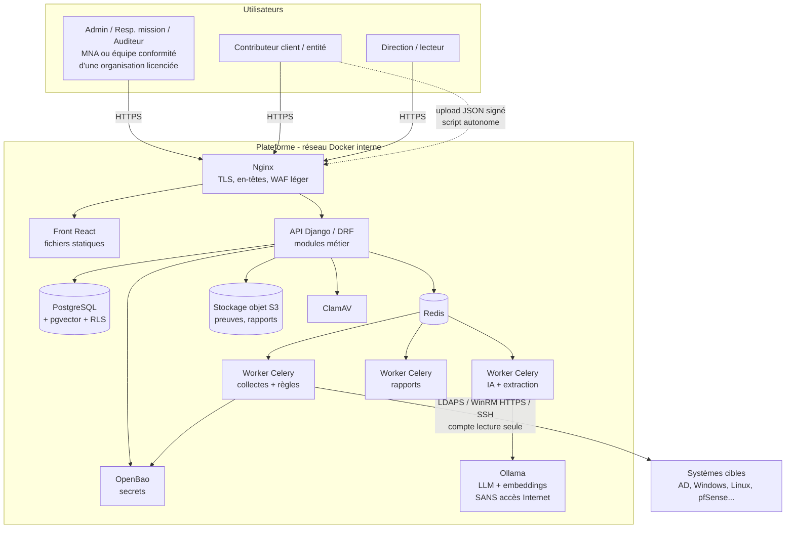
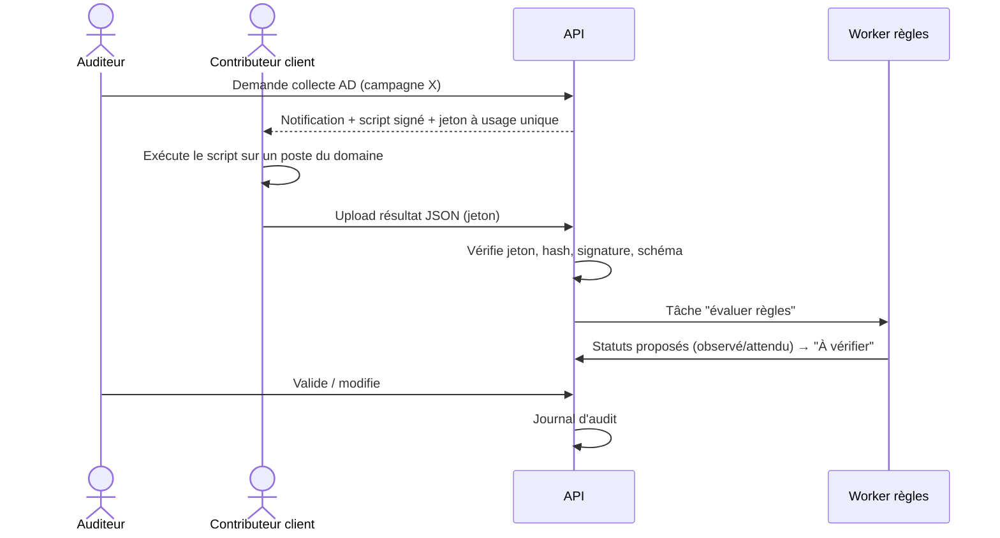
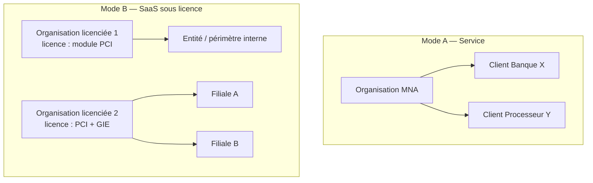

# Architecture technique (proposition)

> Mise à jour du 09/11/2026 après la réunion du 05/11 ([CR](../organisation/Comptes_Rendus/CR_2026-11-05_Reunion_lancement.md)) :
> - **Stack libre** (D5) : décision par **Rostom** avant le 16/11 → comparatif détaillé et références dans [Choix_Technologiques.md](Choix_Technologiques.md). Le tableau du § 2 reprend la recommandation ; **l'architecture logique ne dépend pas de la stack**.
> - **Deux modes de déploiement** (D11) : **A. service** (MNA audite ses clients) et **B. SaaS sous licence** (audits internes d'entreprises) → § 1 et § 6.
> - Dimensionnement du serveur : [Estimation_Ressources_VPS.md](Estimation_Ressources_VPS.md).

---

## 1. Principes directeurs

1. **Un seul code, deux modes** : le même paquet Docker sert en **mode service** (instance MNA), en **SaaS mutualisé** (plusieurs organisations licenciées, isolation « pool » + RLS) et en **SaaS dédié** (instance « silo » chez un client) [D2], [D3], [A14].
2. **On-premise possible** : tout tourne en conteneurs Docker, **sans dépendance Internet** à l'exécution (pas de CDN, pas d'API cloud, modèles IA pré-téléchargés).
3. **Référentiels = données** : rien de spécifique à PCI ou GIE dans le code (CDC § 6).
4. **Sécurité by design** (exigée par MNA, D12) : multi-tenant strict, RBAC côté serveur, journal d'audit, secrets en coffre (CDC § 14).
5. **Asynchrone pour le lourd** : IA, collectes, génération de rapports → files de tâches (CDC § 15).
6. **Simplicité** : un « monolithe modulaire » + quelques services techniques, **pas de microservices** (inutile pour un PFE et plus dur à sécuriser).

## 2. Stack recommandée (résumé — détail et justification dans [Choix_Technologiques.md](Choix_Technologiques.md))

| Couche | Choix proposé | Pourquoi | Alternative |
|---|---|---|---|
| Back-end | **Python 3.12 + Django 5 + Django REST Framework** | ORM robuste, migrations, admin intégré, auth/permissions matures, écosystème sécurité ; Python = langage idéal pour l'IA, les collecteurs et les rapports ; même stack que CISO Assistant | FastAPI (plus léger, mais plus à construire : auth, admin) |
| Front-end | **React + TypeScript + Vite** + bibliothèque UI (shadcn/ui ou MUI) + TanStack Query + Recharts | Très répandu, beaucoup de ressources | Vue 3 / SvelteKit |
| Base de données | **PostgreSQL 16** + **pgvector** | Fiable, JSONB pour règles/données de collecte, RLS pour l'isolation, vecteurs pour le RAG dans la même base | — |
| Files de tâches | **Celery + Redis** | Standard Python | Dramatiq, RQ |
| Stockage des preuves | **API S3** (`django-storages`) → **SeaweedFS** (Apache 2.0) ou FS chiffré au MVP | On-prem, séparation fichiers/BDD ; ⚠️ MinIO CE est en mode maintenance depuis fin 2025 [G2] | Garage (AGPL), S3 de l'hébergeur |
| Antivirus | **ClamAV** (clamd) [D5] | Open source, scan à l'upload — ⏳ sous réserve : MNA fournit-elle un antivirus ? | Antivirus fourni par MNA |
| Coffre de secrets | **OpenBao** [D6] (MPL 2.0 ; Vault est passé sous licence BSL en 2023, gênant pour un produit vendu) | Secrets des connecteurs, clés de chiffrement (CDC § 14 Secrets) | Chiffrement applicatif avec clé maîtresse (plus simple, moins bien) |
| IA locale | **Ollama** (dev) — **vLLM** en production GPU / SaaS [A8], [G1] | API locale compatible OpenAI ; sortie = statut + justification (pas de chatbot, D10) | llama.cpp server (CPU) |
| Extraction documents | **Docling** (MIT) [A11] + python-docx + openpyxl ; Tesseract (OCR) | Local ; ⚠️ PyMuPDF est AGPL [D9] | pypdf, pdfplumber |
| Rapports | **WeasyPrint** (PDF depuis HTML/Jinja2), **docxtpl** (Word depuis modèle MNA), **openpyxl** (Excel) | Modèles éditables par MNA sans recompiler | LibreOffice headless |
| Authentification | Django auth + **django-otp** (TOTP) + argon2 ; **Keycloak** (OIDC/SSO par organisation) en Should pour le SaaS | MFA exigée pour rôles sensibles | — |
| Reverse proxy | **Nginx** (TLS 1.2/1.3, en-têtes de sécurité, limite de taille d'upload) | Standard | Traefik, Caddy |
| Commandes de collecte (Lot 2 allégé, D9) | PowerShell, Bash — **bibliothèque fermée de commandes en lecture seule** | Natif sur les cibles | Connecteur distant (perspective) |
| Qualité / CI | ruff, mypy, pytest, ESLint, Vitest, Playwright, Semgrep, Bandit, pip-audit, npm audit, Gitleaks, Trivy | — | — |
| Observabilité (bonus) | Logs JSON + Grafana Loki / Prometheus | — | — |

## 3. Vue en composants



## 4. Modules applicatifs (monolithe modulaire Django)

| App Django | Responsabilité | Lot |
|---|---|---|
| `organizations` | **Organisations (tenants)**, licences, modules activés (PCI, GIE…), quotas — mode SaaS | 1 |
| `accounts` | Utilisateurs, MFA, sessions, rôles, affectations (organisation/client/campagne) | 1 |
| `tenancy` | Entités auditées (clients), contacts, actifs, isolation à 2 niveaux (middleware + managers + RLS) | 1 |
| `frameworks` | Référentiels, versions, domaines, contrôles, import/export, règles d'automatisation | 1 (+2) |
| `campaigns` | Campagnes, machine à états, périmètre, applicabilité, équipe | 1 |
| `assessments` | Évaluations par contrôle (4 méthodes), statut proposé/validé, historique | 1 |
| `evidence` | Preuves, métadonnées, hash, antivirus, stockage, réutilisation, obsolescence | 1 |
| `findings` | Non-conformités, recommandations, actions correctives, retests | 1 |
| `kpi` | Calcul des indicateurs, comparaisons historiques | 1 |
| `reporting` | Génération PDF/Word/Excel/CSV/JSON, modèles | 1 |
| `audit_log` | Journal d'audit append-only | 1 |
| `collectors` | Bibliothèque de commandes fixes, exécutions, résultats normalisés, moteur de règles | 2 (allégé) |
| `ai` | Pipeline d'extraction, RAG, appel LLM, propositions, évaluation | 3 |
| `mapping` | MappingSets, règles, calcul de couverture | 4 (modèle dès Lot 1) |

## 5. Flux clés (séquences)

### 5.1 Évaluation par script autonome


### 5.2 Analyse IA d'une preuve


## 6. Déploiement

### 6.1 Les deux modes métier (réunion 05/11, D11)



| Variante | Hébergement | Isolation | Pour qui |
|---|---|---|---|
| **A — Service** | Instance MNA (VPS ou on-prem) | Entre clients de MNA | MNA |
| **B1 — SaaS mutualisé** | Instance hébergée par MNA, plusieurs organisations | « Pool » : `organization_id` + RLS + tests IDOR [D1], [D2] | Entreprises sans contrainte d'hébergement |
| **B2 — SaaS dédié** | Même paquet Docker déployé chez le client (« silo ») | Physique | Banques exigeantes (souveraineté, loi 18-07 [S12]) |

### 6.2 Environnements
- **Dev** : `docker compose up` sur vos PC (profil sans GPU, petit modèle).
- **Démo / pré-prod** : le **VPS** demandé à MNA (voir [Estimation_Ressources_VPS.md](Estimation_Ressources_VPS.md) : 8–16 vCPU, 32–64 Go RAM, idéalement 1 GPU 24 Go).
- **Livrable « scripts de déploiement »** : `docker-compose.prod.yml`, `.env.example`, script d'initialisation (création de l'organisation et de l'admin, import des référentiels), sauvegarde/restauration (pg_dump + stockage objet + export référentiels), guide de durcissement.
- **Réseaux Docker** : `frontend` (nginx ↔ api) et `backend` interne (`internal: true`) pour BDD, Redis, stockage, LLM → **le LLM n'a aucune route vers Internet** (preuve de l'exigence « IA locale »).

## 7. Structure du dépôt proposée
```
pci-conformity-manager/
├── backend/                 # Django
│   ├── config/              # settings (base, dev, prod)
│   ├── apps/
│   │   ├── accounts/ tenancy/ frameworks/ campaigns/ assessments/
│   │   ├── evidence/ findings/ kpi/ reporting/ audit_log/
│   │   └── collectors/ ai/ mapping/
│   └── tests/
├── frontend/                # React + TS
├── collectors/              # scripts autonomes livrés aux clients
│   ├── windows/  (PowerShell)
│   └── linux/    (bash/python)
├── frameworks-data/         # référentiels & mappings importables (JSON/YAML)
│   ├── pci-dss-4.0.1/
│   ├── gie-fictif-0.1/
│   └── mappings/
├── deploy/                  # docker-compose, nginx, scripts
├── docs/                    # architecture, API, admin, utilisateur
└── .github/workflows/       # CI
```

## 8. Décisions à documenter (ADR — Architecture Decision Records)
Écrire 1 page par décision (contexte, options, décision, conséquences) — très apprécié du jury :
1. Django vs FastAPI
2. Monolithe modulaire vs microservices
3. Stratégie multi-tenant à deux niveaux (pool + RLS vs schéma par organisation vs silo) — mode SaaS
4. Mode de collecte (commandes fixes en script autonome vs connecteur vs agent) — allégé (D9)
5. Choix du LLM et du runtime
6. Format des référentiels (JSON maison inspiré OSCAL vs OSCAL natif)
7. Stockage des preuves (SeaweedFS vs FS chiffré ; abandon de MinIO)
8. Gestion des licences et des modules (SaaS)
