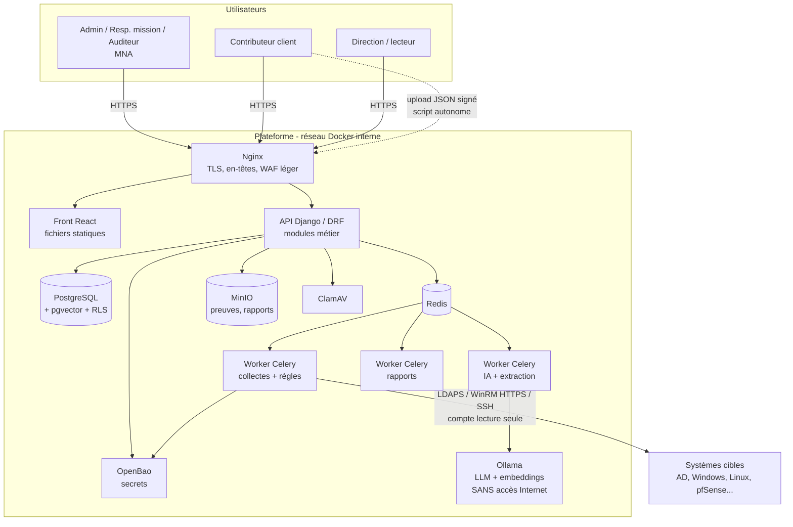
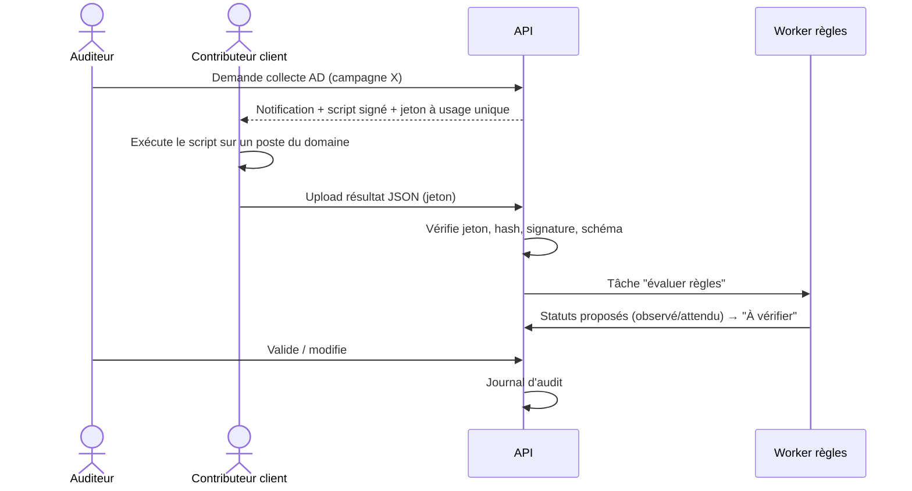
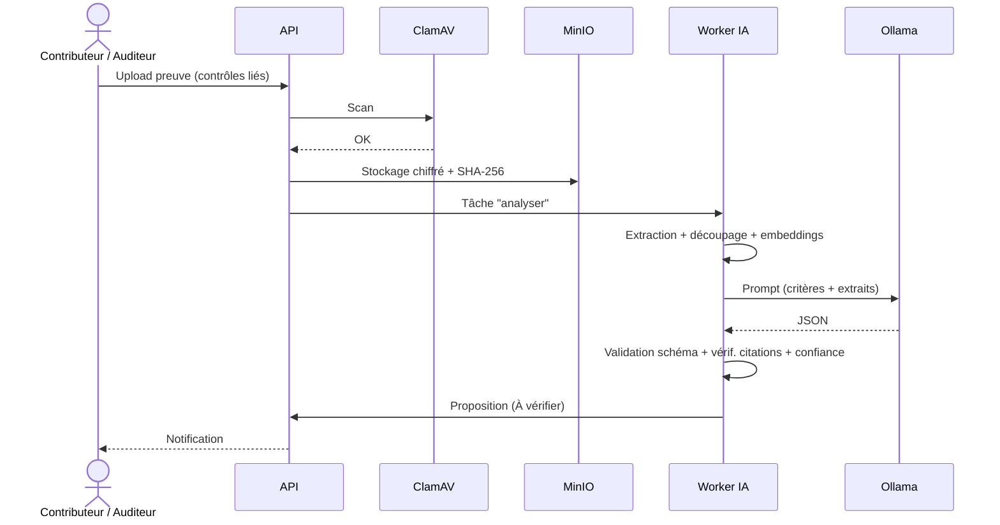

# Architecture technique (proposition à valider avec MNA)

> Proposition argumentée. Si MNA impose une stack (ex. Java/Spring, .NET, Angular), on adapte les composants : **l'architecture logique reste la même**.

---

## 1. Principes directeurs

1. **On-premise first** : tout tourne en conteneurs Docker, **sans dépendance Internet** à l'exécution (pas de CDN, pas d'API cloud, modèles IA pré-téléchargés).
2. **Référentiels = données** : rien de spécifique à PCI ou GIE dans le code (CDC § 6).
3. **Sécurité by design** : multi-tenant strict, RBAC côté serveur, journal d'audit, secrets en coffre (CDC § 14).
4. **Asynchrone pour le lourd** : IA, collectes, génération de rapports → files de tâches (CDC § 15).
5. **Simplicité** : un « monolithe modulaire » + quelques services techniques, **pas de microservices** (inutile pour un PFE et plus dur à sécuriser).

## 2. Stack recommandée

| Couche | Choix proposé | Pourquoi | Alternative |
|---|---|---|---|
| Back-end | **Python 3.12 + Django 5 + Django REST Framework** | ORM robuste, migrations, admin intégré, auth/permissions matures, écosystème sécurité ; Python = langage idéal pour l'IA, les collecteurs et les rapports ; même stack que CISO Assistant | FastAPI (plus léger, mais plus à construire : auth, admin) |
| Front-end | **React + TypeScript + Vite** + bibliothèque UI (shadcn/ui ou MUI) + TanStack Query + Recharts | Très répandu, beaucoup de ressources | Vue 3 / SvelteKit |
| Base de données | **PostgreSQL 16** + **pgvector** | Fiable, JSONB pour règles/données de collecte, RLS pour l'isolation, vecteurs pour le RAG dans la même base | — |
| Files de tâches | **Celery + Redis** | Standard Python | Dramatiq, RQ |
| Stockage des preuves | **MinIO** (compatible S3, chiffrement côté serveur) | On-prem, versioning d'objets, séparation fichiers/BDD | Système de fichiers chiffré |
| Antivirus | **ClamAV** (clamd) | Open source, scan à l'upload (CDC § 14 Fichiers) | — |
| Coffre de secrets | **OpenBao** (fork open source de HashiCorp Vault) ou Vault | Secrets des connecteurs, clés de chiffrement (CDC § 14 Secrets) | Chiffrement applicatif avec clé maîtresse (plus simple, moins bien) |
| IA locale | **Ollama** (dev / petit serveur) — vLLM si serveur GPU | Simple, API HTTP locale, nombreux modèles | llama.cpp server |
| Extraction documents | Docling ou PyMuPDF + python-docx + openpyxl ; Tesseract (OCR) | Local | Unstructured |
| Rapports | **WeasyPrint** (PDF depuis HTML/Jinja2), **docxtpl** (Word depuis modèle MNA), **openpyxl** (Excel) | Modèles éditables par MNA sans recompiler | LibreOffice headless |
| Authentification | Django auth + **django-otp** (TOTP) + argon2 ; option **Keycloak** (OIDC/SSO, MFA) | MFA exigée pour rôles sensibles | — |
| Reverse proxy | **Nginx** (TLS 1.2/1.3, en-têtes de sécurité, limite de taille d'upload) | Standard | Traefik, Caddy |
| Collecteurs | PowerShell 5.1/7, Bash, Python (`ldap3`, `pywinrm`, `paramiko`) | Natif sur les cibles | — |
| Qualité / CI | ruff, mypy, pytest, ESLint, Vitest, Playwright, Semgrep, Bandit, pip-audit, npm audit, Gitleaks, Trivy | — | — |
| Observabilité (bonus) | Logs JSON + Grafana Loki / Prometheus | — | — |

## 3. Vue en composants



## 4. Modules applicatifs (monolithe modulaire Django)

| App Django | Responsabilité | Lot |
|---|---|---|
| `accounts` | Utilisateurs, MFA, sessions, rôles, affectations (client/campagne) | 1 |
| `tenancy` | Clients (tenants), contacts, actifs, isolation (middleware + managers + RLS) | 1 |
| `frameworks` | Référentiels, versions, domaines, contrôles, import/export, règles d'automatisation | 1 (+2) |
| `campaigns` | Campagnes, machine à états, périmètre, applicabilité, équipe | 1 |
| `assessments` | Évaluations par contrôle (4 méthodes), statut proposé/validé, historique | 1 |
| `evidence` | Preuves, métadonnées, hash, antivirus, stockage, réutilisation, obsolescence | 1 |
| `findings` | Non-conformités, recommandations, actions correctives, retests | 1 |
| `kpi` | Calcul des indicateurs, comparaisons historiques | 1 |
| `reporting` | Génération PDF/Word/Excel/CSV/JSON, modèles | 1 |
| `audit_log` | Journal d'audit append-only | 1 |
| `collectors` | Définition des collecteurs, exécutions, résultats normalisés, moteur de règles | 2 |
| `ai` | Pipeline d'extraction, RAG, appel LLM, propositions, évaluation | 3 |
| `mapping` | MappingSets, règles, calcul de couverture | 4 (modèle dès Lot 1) |

## 5. Flux clés (séquences)

### 5.1 Évaluation par script autonome


### 5.2 Analyse IA d'une preuve


## 6. Déploiement

- **Dev** : `docker compose up` sur vos PC (profil sans GPU, petit modèle).
- **Démo / pré-prod** : une VM Ubuntu Server (8 vCPU, 32 Go RAM, idéalement GPU pour Ollama) chez MNA, réseau interne.
- **Livrable « scripts de déploiement »** : `docker-compose.prod.yml`, `.env.example`, script d'initialisation (création admin, import référentiels), procédure de sauvegarde/restauration (pg_dump + MinIO mirror + export référentiels), guide de durcissement (pare-feu hôte, mises à jour, utilisateurs).
- **Réseaux Docker** : `frontend` (nginx ↔ api) et `backend` interne (`internal: true`) pour BDD, Redis, MinIO, Ollama → **Ollama n'a aucune route vers Internet** (preuve de l'exigence « IA locale »).

## 7. Structure du dépôt proposée
```
pci-conformity-manager/
├── backend/                 # Django
│   ├── config/              # settings (base, dev, prod)
│   ├── apps/
│   │   ├── accounts/ tenancy/ frameworks/ campaigns/ assessments/
│   │   ├── evidence/ findings/ kpi/ reporting/ audit_log/
│   │   └── collectors/ ai/ mapping/
│   └── tests/
├── frontend/                # React + TS
├── collectors/              # scripts autonomes livrés aux clients
│   ├── windows/  (PowerShell)
│   └── linux/    (bash/python)
├── frameworks-data/         # référentiels & mappings importables (JSON/YAML)
│   ├── pci-dss-4.0.1/
│   ├── gie-fictif-0.1/
│   └── mappings/
├── deploy/                  # docker-compose, nginx, scripts
├── docs/                    # architecture, API, admin, utilisateur
└── .github/workflows/       # CI
```

## 8. Décisions à documenter (ADR — Architecture Decision Records)
Écrire 1 page par décision (contexte, options, décision, conséquences) — très apprécié du jury :
1. Django vs FastAPI
2. Monolithe modulaire vs microservices
3. Stratégie multi-tenant (base partagée + `client_id` + RLS vs une base par client)
4. Mode de collecte (script autonome vs connecteur vs agent)
5. Choix du LLM et du runtime
6. Format des référentiels (JSON maison inspiré OSCAL vs OSCAL natif)
7. Stockage des preuves (MinIO vs fichiers)
