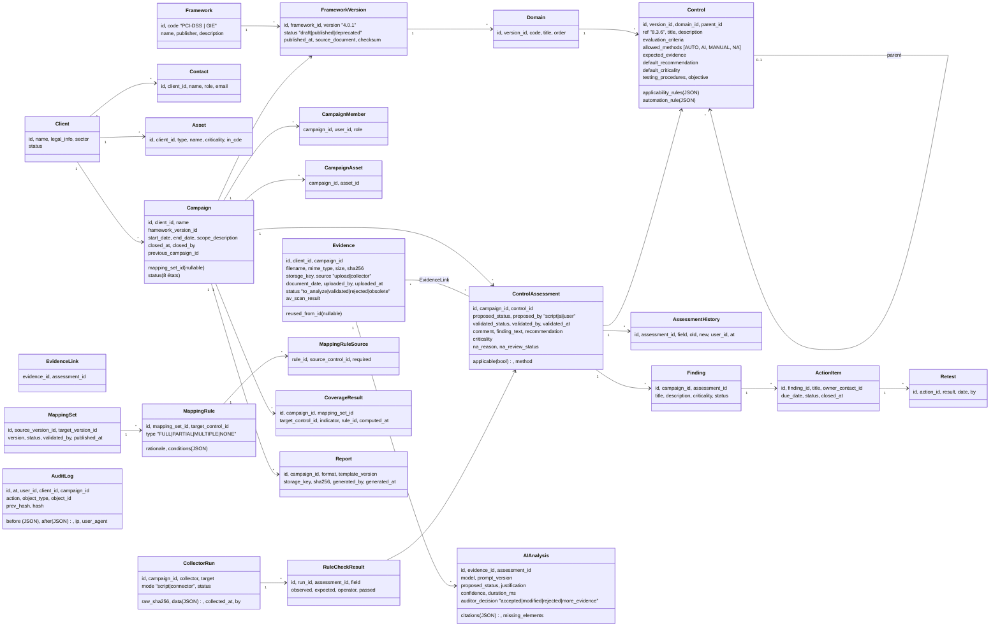

# Modèle de données (proposition)

> Points délicats : **versioning immuable** des référentiels, **multi-tenant**, distinction **statut proposé / validé**, **historique**. Ce modèle couvre les 4 lots ; on implémente les tables au fil des sprints mais on les **conçoit toutes dès la Phase 2**.

---

## 1. Diagramme de classes (simplifié)



## 2. Règles clés

### 2.1 Versioning immuable
- `FrameworkVersion.status = published` ⇒ **aucune modification** de ses `Domain` / `Control` (contrôle applicatif + trigger SQL optionnel). Toute évolution = **nouvelle version** (copie puis édition en `draft`).
- `Campaign.framework_version_id` est fixé à la création et **non modifiable** après « En cours ».
- Même logique pour `MappingSet`.
- Comparer deux campagnes sur deux versions différentes → table optionnelle `ControlEquivalence(old_control_id, new_control_id, type)` (ex. PCI v4.0.1 → future v5).

### 2.2 Multi-tenant (isolation)
- Toutes les tables « client » portent `client_id` (directement ou via `campaign_id`).
- **Défense en profondeur** :
  1. Manager Django par défaut qui filtre sur les clients autorisés de l'utilisateur courant ;
  2. Vérification de permission objet dans chaque vue (DRF `has_object_permission`) ;
  3. **PostgreSQL Row-Level Security** avec `SET app.current_client_ids` par requête (bonus mais excellent argument sécurité) ;
  4. Tests automatiques d'IDOR : pour chaque endpoint, un utilisateur du client A tente d'accéder à un objet du client B → 404.
- Les identifiants exposés sont des **UUID** (non devinables), pas des entiers séquentiels.

### 2.3 Statut proposé vs validé
- `proposed_status` (script, IA ou saisie) et `validated_status` (décision de l'auditeur).
- Les KPI et le mapping n'utilisent **que** `validated_status` ; un contrôle avec proposition non validée compte comme « À vérifier ».
- Chaque changement → `AssessmentHistory` + `AuditLog`.

### 2.4 Clôture
- Passage à « Clôturée » ⇒ campagne en **lecture seule** (tous les objets liés), rapport final généré et **haché** (`Report.sha256`).

### 2.5 Journal d'audit infalsifiable (bonus apprécié)
- Table **append-only** (pas d'UPDATE/DELETE : droits SQL retirés au rôle applicatif).
- **Chaînage de hash** : `hash = SHA256(prev_hash + contenu)` → toute modification d'une ligne casse la chaîne ; commande de vérification d'intégrité.

## 3. Énumérations

| Enum | Valeurs |
|---|---|
| Statut campagne | DRAFT, PREPARATION, IN_PROGRESS, WAITING_EVIDENCE, VALIDATION, REMEDIATION, RETEST, CLOSED |
| Statut contrôle | COMPLIANT, PARTIAL, NON_COMPLIANT, TO_VERIFY, WAITING_EVIDENCE, NOT_ASSESSED, NA |
| Méthode | AUTO, AI, MANUAL, NA |
| Statut preuve | TO_ANALYZE, VALIDATED, REJECTED, OBSOLETE |
| Type mapping | FULL, PARTIAL, MULTIPLE, NONE |
| Indicateur couverture | COVERED, PARTIAL, NOT_COVERED, NOT_MAPPED, TO_VERIFY |
| Criticité | CRITICAL, HIGH, MEDIUM, LOW |
| Rôle | SUPER_ADMIN, MISSION_MANAGER, AUDITOR, CLIENT_CONTRIBUTOR, READER |

## 4. Format d'import d'un référentiel (extrait)

```yaml
framework:
  code: PCI-DSS
  name: Payment Card Industry Data Security Standard
  publisher: PCI Security Standards Council
version:
  version: "4.0.1"
  source_document: "PCI-DSS-v4_0_1.pdf"
domains:
  - code: "8"
    title: "Identifier les utilisateurs et authentifier l'accès"
    controls:
      - ref: "8.3.6"
        parent: "8.3"
        title: "Exigences de longueur et de complexité des mots de passe"
        evaluation_criteria:
          - "Longueur minimale de 12 caractères (ou 8 si non supporté)"
          - "Caractères numériques et alphabétiques"
        applicability: { requires_asset_types: ["directory", "server", "application"] }
        allowed_methods: [AUTO, AI, MANUAL, NA]
        expected_evidence: ["Export de politique de mots de passe", "Paramètres GPO/FGPP"]
        default_recommendation: "Configurer une politique imposant au moins 12 caractères…"
        default_criticality: HIGH
        automation_rule:
          collector: ad.password_policy
          checks:
            - { field: min_password_length, op: ">=", value: 12 }
            - { field: complexity_enabled, op: "==", value: true }
```
→ Rédiger le **JSON Schema** correspondant pour valider les imports (🤖 Claude peut le générer).
