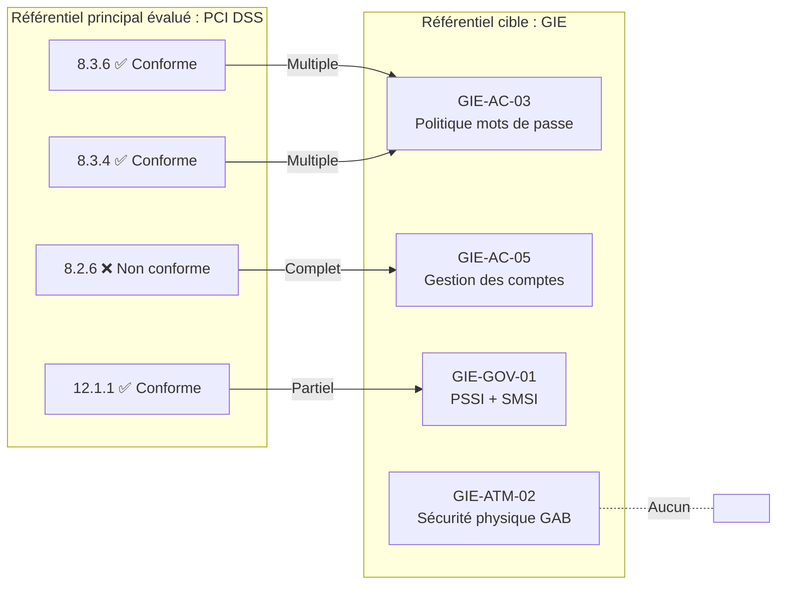
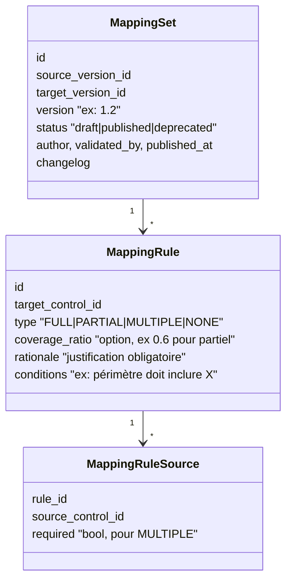

# Le moteur de mapping croisé PCI DSS ↔ GIE Monétique

> Fonction **centrale** du CDC (§ 7–8). Ce fichier explique le concept, propose un **modèle de données**, un **algorithme** fidèle aux 5 règles du CDC, des cas limites, et une méthode pour **construire** le mapping avec MNA.

---

## 1. Le concept en une image


Résultat estimé : G1 **Couvert** (les 2 contrôles du groupe multiple sont conformes) · G2 **Non couvert** (la source est non conforme) · G3 **Partiellement couvert** (mapping partiel → jamais « couvert ») · G4 **Non mappé** (évaluation directe nécessaire).

*(identifiants GIE inventés pour l'exemple)*

---

## 2. Vocabulaire précis

- **Contrôle source** : contrôle du référentiel principal de la campagne, **évalué directement**.
- **Contrôle cible** : contrôle de l'autre référentiel, dont on **estime** la couverture.
- **Relation de mapping** : lien orienté source(s) → cible, avec un **type** (Complet, Partiel, Multiple, Aucun).
- **Bidirectionnalité** : le CDC demande « et inversement ». Attention : un mapping **n'est pas automatiquement symétrique** ! « PCI 8.3.6 couvre complètement GIE-AC-03 » n'implique pas « GIE-AC-03 couvre complètement PCI 8.3.6 » (GIE-AC-03 peut être moins exigeant, ex. 8 caractères au lieu de 12). → Stocker **les deux sens explicitement** (ou un type par direction).

---

## 3. Modèle de données proposé



- Un **MappingSet** relie **une version source** à **une version cible** (ex. PCI DSS v4.0.1 → GIE v2.0) et est lui-même **versionné** (règle 5 du CDC). Une campagne enregistre quel `MappingSet` a servi au calcul → reproductibilité.
- Une **MappingRule** est centrée sur **un contrôle cible** et liste **ses sources** : c'est plus simple pour le calcul (on calcule la couverture cible par cible).
- `NONE` peut être stocké explicitement (« analysé, aucune correspondance » ≠ « pas encore analysé » = Non mappé). Bonne distinction à montrer au jury.

---

## 4. Algorithme de calcul de couverture (fidèle au CDC § 8.1)

### 4.1 Entrées
- Résultats **validés** des contrôles source de la campagne (statut validé par l'auditeur, pas le statut proposé).
- Le `MappingSet` publié choisi.
- Le périmètre de la campagne (pour la règle de cohérence).

### 4.2 Table de décision par type

| Type | Statuts des sources | Indicateur cible |
|---|---|---|
| **Aucune règle** pour la cible | — | **Non mappé** |
| **NONE** | — | **Non couvert** (à évaluer directement) |
| **FULL** | source Conforme | **Couvert** *(règle 1)* — ou **À vérifier** si conditions de périmètre/preuves non satisfaites |
| FULL | source Partiellement conforme | **Partiellement couvert** |
| FULL | source Non conforme | **Non couvert** |
| FULL | source N/A | **À vérifier** (la non-applicabilité côté source ne prouve pas la non-applicabilité côté cible) |
| FULL | source Non évalué / En attente / À vérifier | **Non couvert** (« aucun résultat suffisant ») |
| **PARTIAL** | source Conforme | **Partiellement couvert** — **jamais Couvert** *(règle 2)* |
| PARTIAL | source Partiel | Partiellement couvert |
| PARTIAL | source Non conforme / non évaluée | Non couvert |
| **MULTIPLE** | **toutes** les sources requises Conformes | **Couvert** *(règle 3)* (ou À vérifier si conditions) |
| MULTIPLE | au moins une Conforme ou Partielle, mais pas toutes Conformes | **Partiellement couvert** |
| MULTIPLE | aucune Conforme/Partielle | Non couvert |
| MULTIPLE | une source requise **non évaluée** | Au mieux **Partiellement couvert** (règle 3 : *tous* doivent être pris en compte) |

**Règle de sécurité générale :** en cas de doute → l'indicateur le **plus prudent**. Le moteur ne doit jamais sur-estimer la conformité.

**Plusieurs règles pour une même cible ?** (ex. une règle FULL depuis A et une règle MULTIPLE depuis B+C) : calculer chaque règle et retenir le **meilleur** résultat, en conservant la trace de la règle utilisée.

### 4.3 Pseudo-code

```python
ORDER = {"COVERED": 3, "PARTIAL": 2, "NOT_COVERED": 1}

def evaluate_rule(rule, results, campaign):
    statuses = [results.get(s.source_control_id, "NOT_ASSESSED") for s in rule.sources]

    if rule.type == "NONE":
        return "NOT_COVERED"

    if rule.type == "FULL":
        s = statuses[0]
        if s == "COMPLIANT":
            return "TO_VERIFY" if not conditions_ok(rule, campaign) else "COVERED"
        if s == "PARTIAL":   return "PARTIAL"
        if s == "NA":        return "TO_VERIFY"
        return "NOT_COVERED"

    if rule.type == "PARTIAL":
        ok = any(st in {"COMPLIANT", "PARTIAL"} for st in statuses)
        return "PARTIAL" if ok else "NOT_COVERED"

    if rule.type == "MULTIPLE":
        required = [st for st, src in zip(statuses, rule.sources) if src.required]
        if all(st == "COMPLIANT" for st in required):
            return "TO_VERIFY" if not conditions_ok(rule, campaign) else "COVERED"
        if any(st in {"COMPLIANT", "PARTIAL"} for st in statuses):
            return "PARTIAL"
        return "NOT_COVERED"

def compute_coverage(target_controls, mapping_set, results, campaign):
    out = {}
    for target in target_controls:
        rules = mapping_set.rules_for(target)
        if not rules:
            out[target] = Coverage("NOT_MAPPED", rule=None)
            continue
        evaluated = [(evaluate_rule(r, results, campaign), r) for r in rules]
        # "TO_VERIFY" passe devant un simple PARTIAL/NOT_COVERED : il faut un humain
        out[target] = pick_best(evaluated)
    return out   # + toujours étiqueté "couverture ESTIMÉE"
```

### 4.4 Les KPI de couverture
- **Taux de couverture estimé** = Couverts / (cibles applicables)
- Répartition Couvert / Partiel / Non couvert / Non mappé / À vérifier (graphique en anneau + heatmap par domaine cible)
- **Effort restant** = nombre de contrôles cibles à évaluer directement (Non couvert + Non mappé + À vérifier) → c'est **le gain concret** pour MNA : « pour faire le GIE après le PCI, il ne reste que 120 contrôles sur 350 à évaluer ».

### 4.5 Affichage obligatoire
Partout (écran, rapport section 11) : bandeau **« Couverture estimée par mapping — ne constitue pas une évaluation directe »** + version du MappingSet utilisée.

---

## 5. Cas limites à tester (tests unitaires obligatoires)

| # | Cas | Attendu |
|---|---|---|
| T1 | FULL + source Conforme + conditions OK | Couvert |
| T2 | PARTIAL + source Conforme | Partiellement couvert (**jamais** Couvert) |
| T3 | MULTIPLE (A, B, C) : A, B Conformes, C Non évalué | Partiellement couvert |
| T4 | MULTIPLE : toutes Conformes | Couvert |
| T5 | Aucune règle | Non mappé |
| T6 | NONE explicite | Non couvert |
| T7 | FULL + source N/A | À vérifier |
| T8 | FULL + source Conforme mais périmètre campagne ≠ condition | À vérifier |
| T9 | Statut proposé « Conforme » par l'IA mais non validé | Non couvert (seuls les statuts validés comptent) |
| T10 | Nouvelle version du MappingSet publiée après clôture | Le résultat de la campagne clôturée **ne change pas** |
| T11 | Deux règles pour la même cible (FULL non conforme + MULTIPLE conforme) | Couvert via MULTIPLE, règle tracée |

---

## 6. Construire le mapping (travail d'expert, Phase 1bis)

### Méthode recommandée
1. **Normaliser** les deux référentiels en tableur : ID, domaine, texte, objectif.
2. **Pré-classer par domaine** (accès ↔ accès, journalisation ↔ journalisation) pour limiter les comparaisons.
3. **Générer des candidats** :
   - manuellement par domaine ;
   - avec l'aide de Claude (🤝 je propose des paires avec justification) ;
   - plus tard dans la plateforme via **similarité d'embeddings** (bonus Lot 4).
4. **Qualifier** chaque candidat avec la grille ci-dessous.
5. **Faire valider** par un consultant MNA (🙋 obligatoire), noter le validateur et la date.
6. **Publier** une version (`v0.1` → `v1.0`) et l'importer.

### Grille de qualification
| Question | Si oui |
|---|---|
| La source exige-t-elle **au moins autant** que la cible, sur **le même objet** et **le même périmètre** ? | FULL |
| La source couvre-t-elle seulement **certains aspects** de la cible (ou est moins stricte : 8 vs 12 caractères, annuel vs trimestriel) ? | PARTIAL |
| Faut-il **combiner plusieurs** sources pour couvrir tous les aspects de la cible ? | MULTIPLE (lister chaque source et si elle est requise) |
| Aucune source ne traite l'objet de la cible ? | NONE |
| La correspondance dépend d'un **contexte** (ex. seulement si les GAB sont dans le périmètre) ? | Ajouter une **condition** → peut donner « À vérifier » |

### Format d'échange (fichier versionné dans Git)
```json
{
  "mapping_set": {
    "source": {"framework": "PCI-DSS", "version": "4.0.1"},
    "target": {"framework": "GIE-MONETIQUE", "version": "X.Y"},
    "version": "0.1",
    "status": "draft",
    "author": "Binôme PFE",
    "validated_by": null
  },
  "rules": [
    {
      "target": "GIE-AC-03",
      "type": "MULTIPLE",
      "sources": [
        {"control": "8.3.6", "required": true},
        {"control": "8.3.4", "required": true}
      ],
      "rationale": "La politique GIE couvre longueur + verrouillage ; PCI les traite séparément.",
      "conditions": []
    }
  ]
}
```

---

## 7. Références utiles
- **NIST OLIR** (Online Informative References) : méthodologie NIST de mapping entre référentiels avec types de relations (*subset of, intersects with, equal, superset of, not related to*) → bonne référence académique pour justifier vos 4 types. Correspondance : *equal / superset of* ≈ Complet ; *intersects with / subset of* ≈ Partiel ; *not related* ≈ Aucun.
- **Secure Controls Framework (SCF)** et **CISO Assistant** : mappings entre de nombreux référentiels, utiles comme exemples (PCI ↔ ISO 27001 notamment, ce qui aide puisque le GIE s'inspire d'ISO 27000).
- PCI SSC publie aussi des correspondances (ex. avec NIST CSF) — utiles comme exemple de format.
