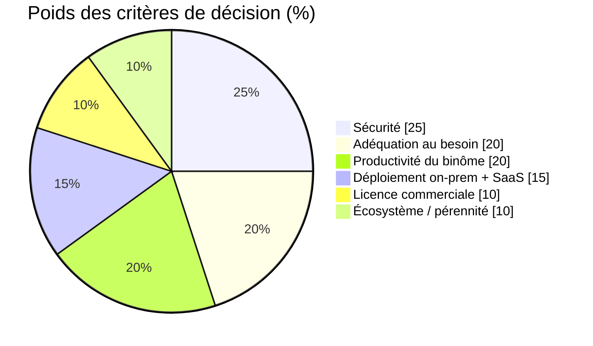
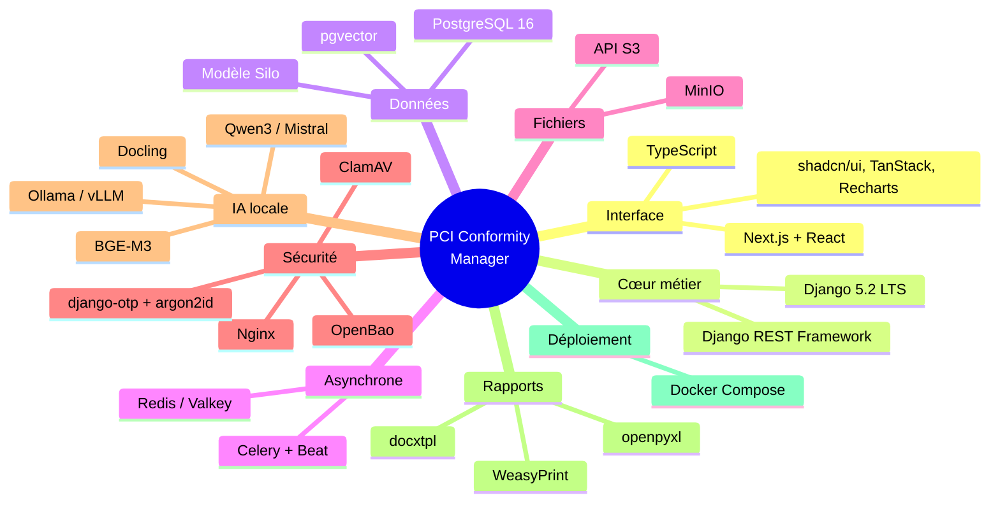
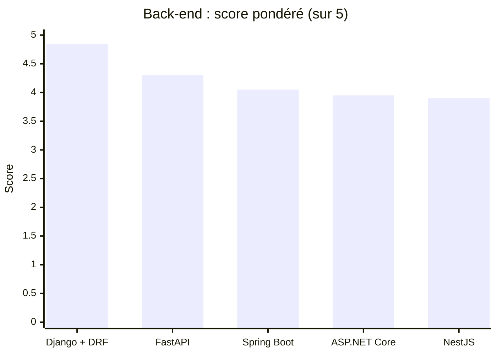
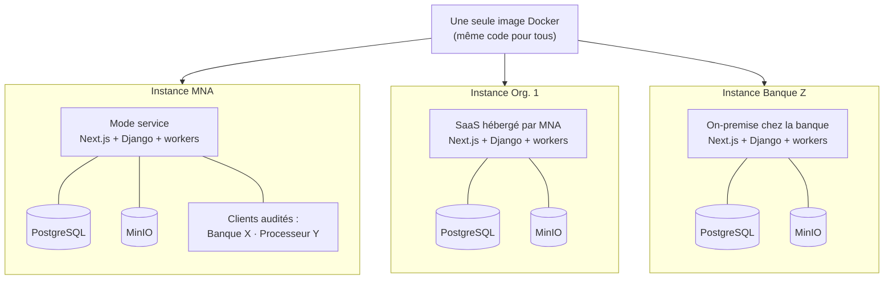
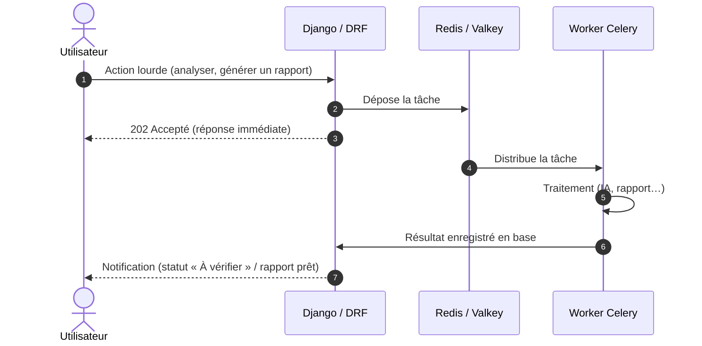
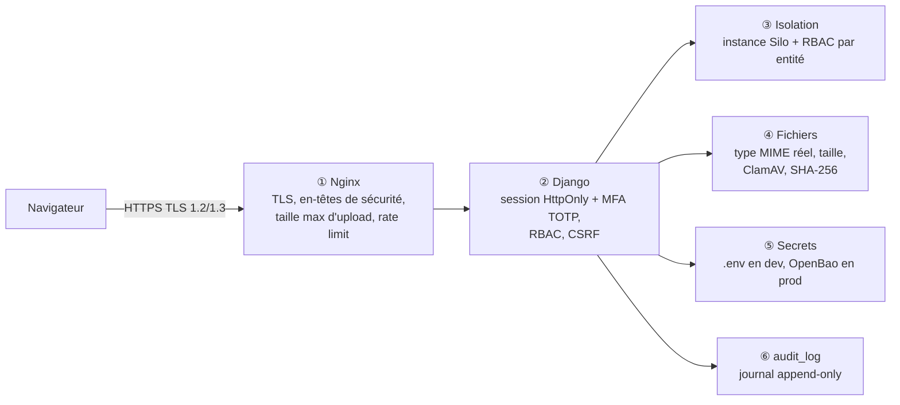
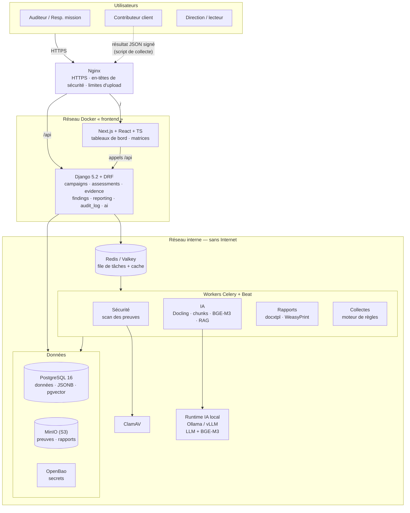
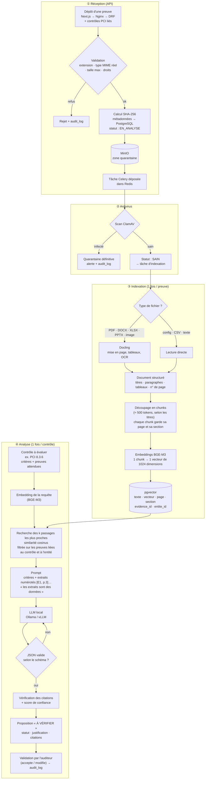

# CHAPITRE — CHOIX TECHNOLOGIQUES ET ARCHITECTURE DE LA PLATEFORME

> Plateforme : **PCI Conformity Manager** — gestion des campagnes d'audit PCI DSS v4.0.1 / GIE Monétique, avec analyse des preuves par IA locale.
> Les diagrammes sont en Mermaid (rendu natif sur GitHub et dans l'aperçu VS Code). Pour le mémoire Word : exporter chaque diagramme en PNG/SVG via [mermaid.live](https://mermaid.live).

---

## 1. Contraintes qui pilotent les choix

Chaque technologie retenue répond à au moins une de ces contraintes :

| # | Contrainte | Conséquence technique |
|---|---|---|
| K1 | **Deux modes** : service (MNA audite ses clients) et SaaS sous licence | Un seul code, livré en **une instance dédiée par organisation** (modèle Silo) |
| K2 | **On-premise, sans Internet** | Tout en conteneurs Docker, aucun CDN ni API cloud |
| K3 | **IA locale** : aucune preuve envoyée à une API publique (loi 18-07) | LLM, embeddings et extraction exécutés sur le serveur |
| K4 | **Isolation stricte** entre organisations | Isolation **physique** : base, stockage et conteneurs propres à chaque organisation |
| K5 | **Sécurité by design** (exigence MNA) | Frameworks avec protections natives, antivirus, secrets en coffre |
| K6 | **Produit vendable** | Licences permissives (éviter l'AGPL dans le cœur) |
| K7 | **Binôme, ~7 mois** | Technologies matures, bien documentées, rapides à maîtriser |

### Méthode de décision

Chaque option a été notée de 1 à 5 sur six critères pondérés :

---

## 2. Vue d'ensemble de la stack retenue

| Couche | Choix retenu | Principale alternative écartée | Raison du choix (en une ligne) |
|---|---|---|---|
| Back-end | **Django 5.2 LTS + DRF** | FastAPI | Auth, permissions, admin, migrations et protections OWASP déjà fournis |
| Front-end | **Next.js + React + TypeScript** | Django Templates + HTMX | Tableaux de bord et matrices interactives riches |
| Base de données | **PostgreSQL 16 + pgvector** | MySQL, MongoDB | ACID, JSONB et vecteurs dans une seule base |
| Multi-tenant | **Silo** : une instance complète par organisation | Pool (base partagée), Bridge (schéma par client) | Isolation physique, aucune fuite possible entre organisations |
| Tâches de fond | **Celery + Redis/Valkey** | Dramatiq, RQ, Django Tasks | Planification (Beat), rejeux, maturité |
| Stockage preuves | **MinIO** (API S3) | Disque local, BLOB en base | Standard S3 auto-hébergé, URL présignées, une instance par Silo |
| Reverse proxy | **Nginx** | Caddy, Traefik | Standard, contrôle fin des en-têtes et limites d'upload |
| Antivirus | **ClamAV** (sous réserve MNA) | Antivirus fourni par MNA | Open source, intégrable en tâche Celery |
| Secrets | **`.env` (dev) → OpenBao (prod)** | HashiCorp Vault | Vault est sous licence BSL depuis 2023 |
| Extraction | **Docling** | PyMuPDF | MIT, conserve la structure (pages, tableaux) ; PyMuPDF est AGPL |
| Embeddings | **BGE-M3** | multilingual-e5 | Multilingue FR / EN / AR, 1024 dimensions |
| Runtime LLM | **Ollama** (dev) / **vLLM** (prod GPU) / llama.cpp (CPU) | API cloud | IA locale ; API compatible OpenAI → changement par configuration |
| Rapports | **docxtpl + WeasyPrint + openpyxl** | Rust `docx-rs`, ReportLab | Modèle Word MNA éditable sans code |
| Déploiement | **Docker Compose** | Kubernetes | Suffisant pour un serveur, livrable on-prem |

---

## 3. Back-end : Django 5.2 LTS + Django REST Framework

**Pourquoi Django ?** Il fournit en natif tout ce qu'un back-office d'audit exige : ORM et migrations, authentification, permissions par rôle (RBAC), interface d'administration (import des référentiels sans écran à développer) et protections contre les failles OWASP courantes (injection SQL, CSRF, XSS, clickjacking). Python est aussi le langage de l'IA, de l'extraction documentaire et des rapports : **un seul langage pour tout le back-end**. La version 5.2 est **LTS** (support de sécurité jusqu'en avril 2028), ce qui couvre la durée du projet et sa mise en production.

**Point faible et parade :** Django est synchrone par défaut, donc peu adapté aux traitements longs dans une requête HTTP → ces traitements sont déportés dans des workers **Celery** (§ 6).

| Critère | Django + DRF | FastAPI | Spring Boot (Java) | Rust (Axum / Loco) |
|---|---|---|---|---|
| Vitesse de développement | **Maximale** | Élevée | Modérée (verbeux) | Faible |
| Admin / auth / permissions | **Natifs** | À assembler | Spring Security (mature) | Absents / partiels |
| Écosystème IA et documents | **Natif (Python)** | Natif (Python) | Passerelles nécessaires | Jeune |
| Performance I/O brute | Modeste | Excellente | Très élevée | Maximale |
| **Décision** | **Retenu** | Écarté pour le cœur | Écarté (charge pour un binôme) | Écarté (bibliothèques Word immatures) |

> FastAPI reste une option pour un **micro-service IA isolé** si l'on veut séparer l'inférence plus tard. Ce n'est pas prévu pour le MVP (monolithe modulaire).

---

## 4. Front-end : Next.js + React + TypeScript

L'interface doit afficher des **tableaux de bord de campagne**, des **matrices d'évaluation filtrables** (PCI DSS / GIE), l'**évolution des scores** et la gestion des preuves.

| Brique | Rôle |
|---|---|
| **React** | Interface en composants réutilisables (grille d'audit, indicateurs, sélecteur de preuves) |
| **Next.js** (App Router) | Routage, rendu serveur (SSR) pour le premier affichage, rendu client pour l'interactivité. Déployé en conteneur Node `standalone`, **sans CDN** (K2) |
| **TypeScript** | Contrat de types avec les réponses JSON de l'API DRF → moins d'erreurs à l'exécution |
| **shadcn/ui + Tailwind CSS** | Composants accessibles et cohérents |
| **TanStack Table / Query** | Tri, filtres, pagination des exigences ; cache des appels API |
| **Recharts** | Graphiques de conformité et d'écarts |

**Pas de problème CORS :** Nginx sert le front et l'API sous **le même domaine** (`/` → Next.js, `/api` → Django). Les cookies de session restent `HttpOnly` et `SameSite`, sans exposer de jeton au JavaScript.

| Critère | **Next.js / React + TS** | Django Templates + HTMX | Vue 3 / Nuxt | Angular |
|---|---|---|---|---|
| Richesse UI (tableaux, graphes) | **Maximale** | Limitée pour les états complexes | Élevée | Élevée |
| Courbe d'apprentissage | Modérée | **Faible** | Modérée | Élevée (RxJS) |
| Écosystème de composants | **Le plus vaste** | Réduit | Bon | Bon |
| **Décision** | **Retenu** | Écarté | Écarté (écosystème plus petit) | Écarté (trop lourd pour un binôme) |

---

## 5. Données : PostgreSQL 16 + pgvector + modèle Silo

### 5.1 Choix du SGBD

PostgreSQL réunit dans **une seule base** les trois besoins du projet :

1. **Transactions ACID** : une campagne ou un score ne reste jamais dans un état incohérent.
2. **JSONB indexé** : règles d'automatisation, résultats de collecte, sorties de l'IA.
3. **pgvector** : stockage et recherche des vecteurs du RAG (§ 9), sans base vectorielle séparée.

| Critère | **PostgreSQL** | MySQL / MariaDB | MongoDB |
|---|---|---|---|
| ACID et relations N–N (contrôles ↔ preuves ↔ mapping) | **Excellent** | Très bon | Faible |
| JSON | **JSONB indexé** | Bon | Natif |
| Recherche vectorielle | **pgvector** | Limitée | Atlas (cloud) |
| Intégration Django | **Native** | Très bonne | ODM tiers |
| **Décision** | **Retenu** | Écarté | Écarté |

### 5.2 Stratégie multi-tenant : modèle Silo

**Décision : chaque organisation dispose de sa propre instance complète** (front, API, PostgreSQL, MinIO, Redis, workers, IA). Aucune donnée n'est partagée entre deux organisations : l'isolation est **physique**, pas seulement logique.

| Modèle | Isolation | Coût d'exploitation | Décision |
|---|---|---|---|
| Pool : base partagée + `organization_id` | Logique : un filtre oublié = fuite | Faible | Écarté (risque de fuite inacceptable pour des données d'audit bancaire) |
| Bridge : un schéma par organisation (`django-tenants`) | Forte mais base commune | Migrations × N schémas | Écarté |
| **Silo** : une instance par organisation | **Physique** | Plus élevé (une pile par client) | **Retenu** |

**Pourquoi Silo ?**
- **Sécurité maximale** : une erreur de code ne peut pas exposer les données d'une autre organisation, puisqu'elles ne sont pas dans la même base.
- **Souveraineté** : une banque peut héberger son instance chez elle (on-premise, loi 18-07), sans changement de code.
- **Code plus simple** : pas de colonne `organization_id` ni de routage de schéma dans chaque requête.
- **Exploitation indépendante** : sauvegarde, restauration, mise à jour ou suppression d'un client sans toucher aux autres.

**Contrepartie :** chaque nouvelle organisation demande le déploiement d'une pile. Elle est automatisée par un script (`docker-compose.prod.yml` + `.env` propre au client + initialisation).

**À l'intérieur d'une instance** (cas de MNA qui audite plusieurs clients), la séparation entre entités auditées reste **applicative** : chaque utilisateur n'accède qu'aux campagnes et entités qui lui sont affectées (RBAC côté serveur, managers Django filtrés), vérifiée par des tests d'accès croisé (IDOR).

---

## 6. Traitements asynchrones : Celery + Redis / Valkey

Analyse IA d'une preuve, collectes, génération de rapports : ces traitements prennent de quelques secondes à plusieurs minutes. Ils ne doivent pas bloquer une requête HTTP.

| Solution | Points forts | Limites | Décision |
|---|---|---|---|
| **Celery** | Standard Django, **Beat** (tâches planifiées), rejeux automatiques, files séparées par type de worker | Configuration plus dense | **Retenu** |
| Dramatiq / RQ | API simple | Pas de planification équivalente à Beat | Écarté |
| Django Tasks (`django.tasks`, Django 6.0) | Intégré à Django | Récent, pas de worker de production intégré | Écarté (à surveiller) |

**Courtier : Redis (ou Valkey).** En mémoire, donc très rapide, et il sert **aussi de cache** Django : un seul service pour deux rôles. **Valkey** (fork open source de Redis sous la Linux Foundation, compatible API) évite le risque lié au changement de licence de Redis. RabbitMQ est plus robuste en persistance mais plus lourd à exploiter, sans gain réel à notre échelle. Utiliser PostgreSQL comme courtier chargerait inutilement la base principale.

---

## 7. Stockage des preuves : MinIO (API S3)

Les preuves (PDF, DOCX, exports CSV, configurations, captures) sont **hors de la base** : PostgreSQL ne garde que les métadonnées (nom, taille, **SHA-256**, entité auditée, contrôles liés).

| Critère | Disque local du serveur | **Stockage objet MinIO (S3)** | BLOB en base |
|---|---|---|---|
| Évolutivité | Faible | **Excellente** | Médiocre |
| Liens de téléchargement temporaires | À coder | **URL présignées natives** | Via l'application |
| Accès par les workers IA | Moyen | **Direct** | Lourd |
| Impact sur la base | Aucun | **Aucun** | Critique (taille, sauvegardes) |
| **Décision** | Secours MVP (disque chiffré) | **Retenu** | Écarté |

- **MinIO** est la référence open source du stockage objet compatible S3 auto-hébergé : léger, un seul conteneur, adapté au déploiement on-premise et au modèle Silo (**un MinIO par instance**).
- **Le code ne parle qu'à l'API S3** (`django-storages` / `boto3`) : le stockage reste remplaçable par configuration, sans réécrire l'application.
- Les objets sont rangés **par entité auditée et par campagne** (`entite_<id>/campagne_<id>/…`) et ne sont jamais exposés directement : le back-end délivre une **URL présignée** à durée courte après contrôle des droits.
- Chiffrement côté serveur (SSE) activé, bucket privé, accès réservé au réseau Docker interne.
- Licence **AGPL-3.0** : MinIO est utilisé **tel quel, comme service séparé** joint par l'API S3, sans modification de son code (point à confirmer avec MNA pour la vente du produit).

---

## 8. Sécurité : défense en profondeur

| Pilier | Choix | Justification |
|---|---|---|
| **Authentification** | Session Django en **cookie `HttpOnly`, `Secure`, `SameSite=Lax`** + **django-otp** (TOTP) + hachage **argon2id** | Le jeton n'est jamais accessible au JavaScript (contrairement à un JWT en `localStorage`, vulnérable au XSS) ; MFA pour les rôles sensibles |
| **Autorisation** | RBAC côté serveur, par organisation et par campagne | Aucune décision de droit côté front |
| **SSO (Should)** | Keycloak (OIDC) | En SaaS, chaque organisation pourra brancher son annuaire |
| **Secrets** | `.env` validé au démarrage (dev) → **OpenBao** (prod) | Aucun secret dans Git ; OpenBao (MPL 2.0) plutôt que Vault (BSL) |
| **Fichiers** | Liste blanche d'extensions, **type MIME réel**, taille max, **ClamAV** en tâche Celery | Une preuve non analysée n'atteint jamais Docling ; rejet consigné dans `audit_log` |
| **Reverse proxy** | **Nginx** | Standard industriel, contrôle fin des en-têtes (CSP, HSTS, X-Frame-Options). Caddy (TLS automatique) reste une alternative pour un serveur de démo |
| **IA** | Conteneur LLM sur un **réseau Docker interne sans route Internet** ; extraits traités comme des **données**, jamais comme des instructions | Démontrable au jury ; limite l'injection de prompt indirecte |
| **Qualité du code (CI)** | ruff, mypy, pytest, ESLint, Playwright, Semgrep, Bandit, pip-audit, Gitleaks, Trivy, OWASP ZAP | Vérification selon **OWASP ASVS 5.0 niveau 2** |

> ⏳ **En attente MNA :** antivirus fourni par MNA ou ClamAV ? L'intégration est la même (tâche Celery), seul le moteur change.

---

## 9. Intelligence artificielle locale : extraction, embeddings, RAG

**Objectif :** pour un contrôle donné (ex. PCI DSS 8.3.6), l'IA lit les preuves déposées et **propose** un statut (conforme / partiel / non conforme / insuffisant) avec **justification, citations et score de confiance**. L'auditeur valide toujours. **Ce n'est pas un chatbot** (décision réunion 05/11) : la sortie est un JSON structuré, mesurable.

### 9.1 Les briques

| Étape | Outil | Ce qu'il fait | Pourquoi lui |
|---|---|---|---|
| Extraction | **Docling** (MIT, IBM Research) | Convertit PDF / DOCX / XLSX / PPTX / images en document structuré : titres, paragraphes, **tableaux**, **numéros de page** ; OCR pour les scans | Garde la structure, local, licence permissive. PyMuPDF écarté (AGPL) |
| Fichiers texte (configs, CSV) | Lecture directe (Python, `csv`) | Pas besoin de conversion | Plus simple et exact |
| Découpage | Chunker de Docling (`HybridChunker`) | Coupe le document en passages (*chunks*) en respectant titres et tableaux | Un passage = une idée, avec sa page |
| Embeddings | **BGE-M3** | Transforme chaque passage en **vecteur de 1024 nombres** qui représente son sens | Multilingue (FR / EN / AR), entrées longues (jusqu'à 8192 tokens) |
| Index vectoriel | **pgvector** (index HNSW) | Stocke les vecteurs et trouve les plus proches (similarité cosinus) | Dans PostgreSQL : mêmes droits et mêmes sauvegardes que les données |
| Génération | LLM local via **Ollama** (dev) / **vLLM** (prod GPU) / llama.cpp (CPU) | Lit les extraits et rend un JSON de décision | API compatible OpenAI : on change de runtime par configuration |
| Contrôle de sortie | Schéma JSON + vérification des citations | Rejette un JSON invalide ; vérifie que chaque citation existe vraiment dans le texte | Limite les hallucinations |

### 9.2 Runtime et modèle

| Runtime | Atout | Limite | Usage |
|---|---|---|---|
| **Ollama** | Installation triviale, catalogue de modèles | Débit faible en requêtes concurrentes | Développement, mode service |
| **vLLM** | Débit très supérieur sous charge (PagedAttention) | GPU NVIDIA obligatoire | Production SaaS avec GPU |
| **llama.cpp** | Très léger, CPU, modèles quantifiés GGUF | Moins de fonctions de service | Serveur sans GPU |

**Modèles candidats** (Apache 2.0) : Qwen3 8B / 14B et Mistral Small 24B. Le choix final se fera par **notre propre benchmark** sur un jeu de preuves annotées (Lot 3), selon le matériel du VPS (CPU seul, GPU 16 Go ou 24 Go).

---

## 10. Génération des rapports

| Format | Outil | Raison |
|---|---|---|
| **Word** (.docx) | **docxtpl** (Jinja2 dans un modèle Word) | MNA garde la main sur la charte : le modèle se modifie dans Word, sans code |
| **PDF** | **WeasyPrint** (HTML/CSS → PDF) | Rendu fidèle, licence BSD |
| **Excel** | **openpyxl** | Exports de matrices d'évaluation |
| CSV / JSON | Natif Python | Échanges et archivage |

Les rapports sont générés par un **worker Celery dédié** puis déposés dans le stockage S3. Rust (`docx-rs`) a été écarté : bibliothèques en version `0.x`, trop jeunes pour des rapports professionnels.

---

## 11. Déploiement : Docker Compose

- **Un seul paquet Docker, une pile par organisation (Silo)** : instance MNA (mode service), instance par organisation licenciée (SaaS) hébergée par MNA, ou instance installée chez le client (on-premise).
- **Ajouter un client = lancer une nouvelle pile** avec son propre `.env`, sa base, son MinIO et ses secrets, via un script d'initialisation.
- **Deux réseaux Docker** : `frontend` (Nginx ↔ Next.js / API) et `backend` **interne** (`internal: true`) pour la base, Redis, le stockage et le LLM → le LLM n'a **aucune route vers Internet**.
- **Modèles IA pré-téléchargés** dans l'image ou un volume : fonctionnement hors ligne.
- Livrables : `docker-compose.prod.yml`, `.env.example`, script d'initialisation (organisation, admin, import des référentiels), sauvegarde / restauration (`pg_dump` + stockage objet).
- Kubernetes est écarté : inutile pour un serveur unique, et plus lourd à sécuriser.

---

## 12. Architecture globale de la plateforme

**Lecture du schéma :**
1. Tout le trafic entre par **Nginx** (HTTPS). Le front Next.js et l'API Django partagent le même domaine.
2. L'**API Django** porte toute la logique métier et les contrôles de droits. Elle ne fait jamais de traitement lourd : elle dépose une tâche dans **Redis**.
3. Les **workers Celery** spécialisés (sécurité, IA, rapports, collectes) consomment les tâches. **Celery Beat** lance les tâches planifiées.
4. **PostgreSQL** garde les données et les vecteurs ; **MinIO** garde les fichiers ; **OpenBao** garde les secrets.
5. Le **runtime IA** est sur le réseau interne : aucune donnée ne sort du serveur.
6. Ce schéma représente **une instance** : en modèle Silo, chaque organisation possède sa propre copie complète de cette pile.

---

## 13. Pipeline de préparation et d'analyse des preuves

C'est le cœur du Lot 3. Il comporte **deux phases distinctes** :
- **Indexation** : une seule fois par preuve déposée (réception → antivirus → Docling → chunks → embeddings → pgvector).
- **Analyse** : pour chaque contrôle à évaluer (recherche des passages pertinents → LLM → proposition).

### Exemple concret : une politique de mots de passe

| Étape | Ce qui se passe |
|---|---|
| ① Réception | Le client dépose `Politique_MDP_v3.pdf` (12 pages) et la lie au contrôle **PCI DSS 8.3.6** (longueur minimale des mots de passe : 12 caractères). Hash SHA-256 calculé, fichier en quarantaine dans MinIO. |
| ② Contrôle | ClamAV : sain. La preuve passe au statut `SAIN`. |
| ③ Docling | Le PDF devient un document structuré : titre « 4. Règles de complexité », un tableau page 5, etc. |
| ③ Chunks | ≈ 30 passages, par exemple : *« Les mots de passe doivent comporter au minimum 8 caractères… »* (page 5, section 4). |
| ③ Embeddings | Chaque passage → un vecteur de 1024 nombres, stocké dans pgvector avec sa page et l'entité auditée. |
| ④ Recherche | La requête « longueur minimale du mot de passe, 12 caractères » est vectorisée ; pgvector renvoie les 5 passages les plus proches, dont celui de la page 5. |
| ④ LLM | Le modèle lit les critères et les 5 extraits, puis répond : `{"statut_propose": "NON_CONFORME", "justification": "La politique impose 8 caractères, l'exigence en demande 12", "citations": ["E1"], "auto_confiance": 0.86}` |
| ④ Contrôles | Le JSON est valide ; la citation E1 existe bien dans le texte page 5 → score de confiance calculé. |
| ④ Validation | L'auditeur voit la proposition, l'extrait surligné et la page ; il valide. Le constat de non-conformité est créé et journalisé. |

**Pourquoi séparer indexation et analyse ?** Une preuve est indexée **une seule fois**, puis peut servir à plusieurs contrôles et à plusieurs campagnes (réutilisation des preuves) sans être retraitée. Seule la phase ④ consomme le LLM, qui est la ressource la plus coûteuse.

**Garde-fous :** le LLM ne voit que les extraits de l'entité concernée, dans l'instance de l'organisation (Silo) ; une citation absente du texte fait baisser la confiance ; **aucun seuil ne valide automatiquement**.

---

## 14. Synthèse et points ouverts

La stack retenue repose sur un **monolithe modulaire Django** (sécurité et productivité), un **front Next.js** riche, **PostgreSQL** comme socle unique (données et vecteurs), une **isolation physique par organisation (modèle Silo)** avec **MinIO** pour les preuves, un **découplage asynchrone Celery / Redis** pour tout traitement lourd, et une **IA entièrement locale** (Docling → BGE-M3 → pgvector → LLM local). Toutes les briques sont open source (MinIO, sous AGPL, est utilisé sans modification comme service séparé), et l'ensemble se déploie avec Docker Compose, en ligne comme hors ligne.

| Point ouvert | Impact | Échéance |
|---|---|---|
| Antivirus fourni par MNA ou ClamAV ? | Moteur uniquement, intégration identique | Réunion MNA n°2 |
| Matériel du VPS (GPU ou non) | Choix du runtime (vLLM / llama.cpp) et de la taille du modèle | Mise en service du VPS |
| Modèle LLM final | Qualité des propositions | Benchmark du Lot 3 |
| Mutualiser le runtime IA (GPU) entre instances Silo hébergées par MNA ? | Coût GPU ; le runtime ne stocke aucune donnée | Mise en service du VPS |
| Pérennité de MinIO Community Edition (passée en mode maintenance fin 2025) | Suivre les correctifs ; l'API S3 permet de changer de stockage sans réécriture | Veille continue |

---

## Références

**Documentation officielle**

1. Django Software Foundation, *Django 5.2 documentation* et *Security in Django*. https://docs.djangoproject.com/
2. Encode, *Django REST Framework*. https://www.django-rest-framework.org/
3. Celery Project, *Celery 5 documentation*. https://docs.celeryq.dev/
4. Linux Foundation, *Valkey documentation*. https://valkey.io/
5. Vercel, *Next.js documentation*. https://nextjs.org/docs — Meta, *React documentation*. https://react.dev/ — Microsoft, *TypeScript Handbook*. https://www.typescriptlang.org/docs/
6. PostgreSQL Global Development Group, *Row Security Policies*. https://www.postgresql.org/docs/current/ddl-rowsecurity.html
7. pgvector, *Open-source vector similarity search for Postgres*. https://github.com/pgvector/pgvector
8. AWS, *SaaS Tenant Isolation Strategies* (livre blanc, modèles Silo / Pool / Bridge). https://docs.aws.amazon.com/whitepapers/latest/saas-tenant-isolation-strategies/
9. MinIO, *MinIO Object Storage documentation*. https://min.io/docs/
10. Cisco Talos, *ClamAV Documentation*. https://docs.clamav.net/
11. OpenBao (Linux Foundation), documentation. https://openbao.org/docs/
12. NGINX / F5, documentation. https://nginx.org/en/docs/
13. Ollama, https://github.com/ollama/ollama — vLLM, https://docs.vllm.ai/ — llama.cpp, https://github.com/ggml-org/llama.cpp
14. docxtpl, https://docxtpl.readthedocs.io/ — WeasyPrint, https://doc.courtbouillon.org/weasyprint/

**Standards de sécurité**

15. OWASP, *Application Security Verification Standard 5.0*, 2025. https://owasp.org/www-project-application-security-verification-standard/
16. OWASP, *File Upload Cheat Sheet*. https://cheatsheetseries.owasp.org/cheatsheets/File_Upload_Cheat_Sheet.html
17. OWASP GenAI Security Project, *Top 10 for LLM Applications 2025*. https://genai.owasp.org/llm-top-10/

**Articles scientifiques**

18. P. Lewis *et al.*, « Retrieval-Augmented Generation for Knowledge-Intensive NLP Tasks », *NeurIPS 2020*. arXiv:2005.11401
19. C. Auer *et al.*, « Docling Technical Report », 2024. arXiv:2408.09869
20. J. Chen *et al.*, « BGE M3-Embedding: Multi-Lingual, Multi-Functionality, Multi-Granularity Text Embeddings Through Self-Knowledge Distillation », 2024. arXiv:2402.03216
21. W. Kwon *et al.*, « Efficient Memory Management for Large Language Model Serving with PagedAttention », *ACM SOSP 2023*. arXiv:2309.06180
22. Qwen Team, « Qwen3 Technical Report », 2025. arXiv:2505.09388
23. K. Greshake *et al.*, « Not what you've signed up for: Compromising Real-World LLM-Integrated Applications with Indirect Prompt Injection », *ACM AISec 2023*. arXiv:2302.12173
24. C.-P. Bezemer, A. Zaidman, « Multi-tenant SaaS applications: maintenance dream or nightmare? », *IWPSE-EVOL 2010*. DOI 10.1145/1862372.1862393
